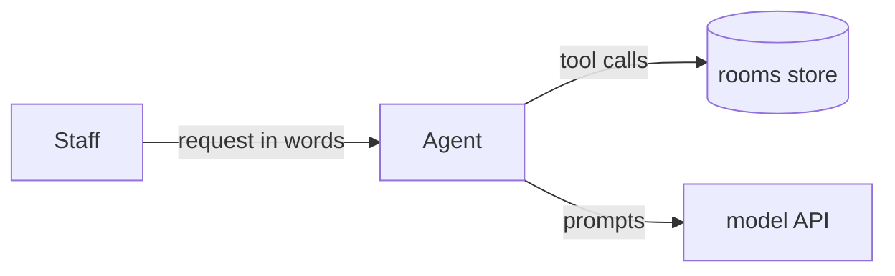

# Interview kit (combined; source: the interview-kit repo)

<!-- AGENTS.md -->
# Working rules for the coding assistant

These rules apply to any AI coding assistant working in this project. Read them before acting.

## How we work

1. **Plan before code.** Write `PLAN.md` from `PLAN.template.md` (see `skills/plan/SKILL.md`):
   goal with the quoted requirements, checkable done-when items, small steps, the shape chosen,
   a one-page system model (or one line saying why none is needed), assumptions and risks. How to think at each
   stage (design chain, model, views, decisions) is in `kit/method/README.md`.
   Wait for approval before editing code (the person types "plan approved" in the chat, so the
   recording shows it). If no person is present (an agent working alone or rehearsing), commit
   the plan and go on: the commit is the record.
2. **One small step at a time.** Each edit does one thing that can be run and checked. No
   multi-file rewrites in one go.
3. **Run it after every change.** Execute the code or the tests after each edit and report the
   actual output. Never say "this should work" without running it.
4. **Tests define done.** Write a small test for each behavior before or with the code. Include
   at least one case where a trivial or wrong implementation would fail.
5. **Fail loudly.** No bare `except:`, no silent fallbacks that hide errors. Raise or log with
   context. A missing API key or bad input is an error message, not an empty result.
6. **Keep it simple.** Standard library and the libraries already in use first. No new
   dependency or abstraction without a stated reason.
7. **Explain as you go.** Every function has a one-line docstring saying what it does and why.
   Non-obvious decisions get a short comment naming the alternative that was rejected.
8. **Say when unsure.** If the spec is ambiguous, state the interpretation chosen and why,
   in the code and in the README, rather than guessing silently.

## Roles (subagents)

Work in four roles, one at a time, each described in `agents/`: **planner** writes `PLAN.md`,
**implementer** does one step and runs it, **tester** writes tests that could fail, **reviewer**
critiques the result against the plan before anything is called done. When asked to act as a
role, follow that file.

## Enforcement

`bash kit/check.sh` checks the plan is concrete, the code compiles and the tests pass, and prints
counts. `bash kit/check.sh --final` also requires every done-when item ticked and the README
sections present. Run it after each step; the work is done only when `--final` passes.

## Agentic AI specifics

- Typed state and typed outputs: `TypedDict` for graph state, Pydantic models for structured
  LLM output (`llm.with_structured_output(Model)`), validated, never parsed with regex.
- Tools have precise names, docstrings and typed arguments: the docstring *is* the prompt the
  model sees. Tools return short, structured strings or dicts and raise clear errors.
- Bound every loop: a maximum number of steps (`recursion_limit`) and an explicit stop condition.
- Keep the LLM swappable: one function builds the model; tests use a fake model so they run
  offline and deterministically.
- Log each step (node name, tool called, arguments, result size) so a run can be traced.
- Evaluate with a handful of concrete cases with known answers, including a failure case;
  report pass/fail per case, not a single score.

## Final deliverable checklist

- [ ] Runs end to end from one command shown in the README.
- [ ] Tests pass; the README shows the command and the result.
- [ ] README: approach, design decisions and rejected alternatives, assumptions, limitations,
      what I would do next with more time.
- [ ] Places where the AI's suggestion was wrong or changed, and why, are noted.

<!-- PLAN.template.md -->
# Plan

## Goal
<2-3 sentences in my words, plus the exact requirement lines quoted from the prompt>

## Done when
- [ ] `<command>` -> `<expected result>`
- [ ] `pytest -v` -> all tests PASSED, none skipped
- [ ] README explains approach, decisions, AI use and limitations

## Steps
1. <smallest runnable step: its test first, then the code>
2. ...

## Shape
<plain code, one structured call, fixed workflow, agent loop, or supervisor; one line per bigger shape rejected and why (skills/plan)>

## System model
<one page per kit/method/system-model.md (goals, context, parts, runtime with the writing function, quality checks, unknowns), or one line: System model: not needed, because REASON>

## Assumptions
- <ambiguity> -> <reading chosen, and why>

## Risks (failure modes)
- <what could make this wrong> -> <how it would show>

<!-- skills/debug/SKILL.md -->
---
name: debug
description: Find the root cause of a failing test, error or wrong agent answer before changing code - read, reproduce, one hypothesis at a time, fix with a test. Use whenever something fails or surprises you.
---

# Skill: debug by root cause, not by guessing

Adapted from obra/superpowers `systematic-debugging` (MIT). In a recorded test, a run of
"try this... try that..." prompts reads as lost control; a stated hypothesis tested in one small
step reads as skill.

**Rule: no fix before you can say what the cause is and why.**

## 1. Read and reproduce

- Read the whole error and stack trace: file, line, exception type, message.
- Reproduce it with one command (`pytest tests/test_x.py::test_y -v`). If it does not fail on
  demand, you are not debugging yet.
- For an agent that answers wrongly, print the trace before touching code: every message, each
  tool call with its arguments, each tool result, the final answer
  (`for step in graph.stream(..., stream_mode="updates"): print(step)`). Then decide which it is:
  - the needed fact never came back from any tool (tool or retrieval problem),
  - it came back but the model ignored or contradicted it (prompt or tool-description problem),
  - the expected answer is itself wrong (test problem).

## 2. Compare with something that works

Find the closest working example (the kit's `examples/`, the library docs, an earlier passing
commit) and list every difference, including the installed version
(`importlib.metadata.version("langgraph")`).

## 3. One hypothesis, one change

- Write it down: "I think X causes this because Y." Ask the AI chat in **Ask** mode to check
  the reasoning, not to fix it.
- Make the smallest change that tests it. Run. If it is wrong, undo it and form a new hypothesis;
  do not pile fixes on top of each other.
- Say "I don't understand X yet" when that is true, then read the source or docs.

## 4. Fix with a test

- First a test that fails for this bug, then the fix, then the full suite.
- After three failed fixes, stop and question the design rather than trying a fourth.

## Stop signs

"Quick fix for now", "just try changing X", several changes before one test run, "it's probably
X" with no evidence, or each fix revealing a new problem elsewhere. Go back to step 1.

Note the bug and its cause in the README's AI section if the AI introduced it.

<!-- skills/evaluate-agent/SKILL.md -->
---
name: evaluate-agent
description: Test an agent offline with a scripted fake model and evaluate it on known cases with per-case pass/fail and trace reading. Use whenever a solution includes an LLM or agent.
---

# Skill: test and evaluate an agent

Use when the solution includes an LLM or agent and needs to show it works.

## Two layers

1. **Deterministic tests (pytest, offline).** Replace the model with a fake that returns
   scripted messages, so the graph logic, tool routing and error handling are tested exactly:

   ```python
   from langchain_core.language_models.fake_chat_models import GenericFakeChatModel
   from langchain_core.messages import AIMessage

   class FakeToolModel(GenericFakeChatModel):
       def bind_tools(self, tools, **kwargs):
           return self  # tools are ignored; replies are scripted

   llm = FakeToolModel(messages=iter([
       AIMessage("", tool_calls=[{"name": "lookup_order", "args": {"order_id": "A-100"}, "id": "1"}]),
       AIMessage("Order A-100 has shipped."),
   ]))
   ```

   Assert on membership, not counts: the right tool was called with the right arguments, and
   the final answer contains the fact the tool returned.

2. **Live evaluation (a small table).** 5-10 questions with known answers, including:
   one needing no tool, one needing two tools, one with bad input, one the agent should refuse
   or say "I don't know". Print a table: question, expected, got, pass/fail, tools used.

## Reading results

- For each failure, look at the full message trace (every tool call, its arguments, what came
  back), then classify: the tool never returned the needed fact, it returned it but the model
  ignored it, or the expected answer was wrong.
- Report pass/fail per case and the trace finding, not just an accuracy number.

<!-- skills/explain-your-work/SKILL.md -->
---
name: explain-your-work
description: Write the README and in-code explanations reviewers read first, including how the AI assistant was used. Use at the end and keep updated while working.
---

# Skill: explain the solution

Use at the end, and keep it updated while working. Reviewers read this first.

## README template

```markdown
# <Task name>

## Run it
<one command>  ->  <what you should see>
Tests: `pytest -v`  ->  N passed

## Approach
Two or three sentences: what the system does and the shape of the solution (a diagram line
like START -> agent -> tools -> agent -> END helps).

## Design decisions
| Decision | Why | Rejected alternative |
|---|---|---|

## Assumptions
Where the spec was ambiguous and which reading I chose.

## How I used the AI assistant
- What I delegated (boilerplate, test cases, API lookups) and what I kept (design, review).
- Where its suggestion was wrong or I changed it, and how I caught it (a failing test, a run).

## Limitations and next steps
What breaks, what is untested, and what I would do with more time.
```

## In the code

- Module docstring at the top: what this file is for.
- One-line docstring per function; comments only for non-obvious "why".

<!-- skills/langgraph-agent/SKILL.md -->
---
name: langgraph-agent
description: Build a tool-calling agent or multi-step graph with LangGraph (state, tools, routing, memory, limits). Use when the task is an agent that uses tools or takes steps.
---

# Skill: build a tool-calling agent with LangGraph

Use when the task is "build an agent that uses tools / takes steps / answers from data".
Tested with langgraph 1.2.14, langchain 1.4.4, langchain-core 1.6.9. Runnable versions:
`examples/agent_template.py` (hand-built graph) and `examples/patterns.py` (structured output,
retrieval tool, human approval), each with offline tests in `tests/`.

## Shape

```
START -> agent --(model asked for tools?)--> tools -> agent ... -> END
```

## Core code

```python
from typing import Annotated, TypedDict
from langchain_core.messages import AnyMessage, SystemMessage
from langchain_core.tools import tool
from langgraph.graph import END, START, StateGraph
from langgraph.graph.message import add_messages
from langgraph.prebuilt import ToolNode, tools_condition


class State(TypedDict):
    messages: Annotated[list[AnyMessage], add_messages]  # add_messages appends, not replaces


@tool
def lookup_order(order_id: str) -> str:
    """Return the status of an order given its ID, e.g. 'A-100'."""
    ...


TOOLS = [lookup_order]


def build_graph(llm):
    llm_with_tools = llm.bind_tools(TOOLS)

    def agent(state: State) -> dict:
        system = SystemMessage("You are a support agent. Use tools for facts; never guess.")
        return {"messages": [llm_with_tools.invoke([system, *state["messages"]])]}

    g = StateGraph(State)
    g.add_node("agent", agent)
    g.add_node("tools", ToolNode(TOOLS))
    g.add_edge(START, "agent")
    g.add_conditional_edges("agent", tools_condition)  # -> "tools" or END
    g.add_edge("tools", "agent")
    return g.compile()


graph = build_graph(llm)
result = graph.invoke({"messages": [("user", "Where is order A-100?")]},
                      config={"recursion_limit": 10})
print(result["messages"][-1].content)
```

## Variations

- **Prebuilt shortcut:** `from langchain.agents import create_agent`;
  `create_agent(llm, tools=TOOLS, system_prompt="...")`. Fine for a first version; hand-built graph
  when custom routing or extra state is needed. Say which and why.
- **Memory across turns:** `graph = g.compile(checkpointer=InMemorySaver())` from
  `langgraph.checkpoint.memory`, then pass `config={"configurable": {"thread_id": "1"}}`.
- **Step limit when you do not control `invoke`** (a grader calls it): set it at build time,
  `graph = create_agent(...).with_config({"recursion_limit": 10})` (checked on langgraph 1.2.14).
- **Structured final answer:** `create_agent(llm, tools, response_format=ToolStrategy(Answer))`
  registers a tool named after the class (`Answer`; a `Reply` class gives a tool `Reply`).
  (`from langchain.agents.structured_output import ToolStrategy`); invalid output is sent back to
  the model to retry, and the result is in `out["structured_response"]`. In a hand-built graph, a
  last node calling `llm.with_structured_output(Answer)`. See `examples/patterns.py`.
- **Retrieval:** a tool returning the top passages as `id: text`, and a clear "No matching
  documents." when nothing matches. See `search_docs` in `examples/patterns.py`.
- **Extra state:** add fields to `State` (e.g. `attempts: int`) and a router function for
  `add_conditional_edges` that returns a node name.
- **Human approval:** `interrupt(payload)` inside a node pauses the run (the caller sees
  `result["__interrupt__"]`); resume with `graph.invoke(Command(resume="yes"), cfg)` on the same
  `thread_id`. Needs a checkpointer. See `build_refund_graph` in `examples/patterns.py`. Inside a
  `@tool` of `create_agent` it also works (pass `checkpointer=`); see the watchlist for the re-run.
- **Retries:** a router that sends to a `check` node, which loops back to
  `agent` with feedback or ends, with a counter so it cannot loop forever.

## Current API watchlist (the IDE's AI may suggest the old form)

Checked 2026-10-11 against the installed packages (`python -c "import importlib.metadata as m; print(m.version('langchain'), m.version('langgraph'))"`; `pip show` fails inside a uv venv). If the
installed versions differ, re-check before trusting this table or the assistant.

| Old form the AI may write | Current form | Checked in |
|---|---|---|
| `from langgraph.prebuilt import create_react_agent` | `from langchain.agents import create_agent` (still imports; calling it warns `LangGraphDeprecatedSinceV10`) | langgraph 1.2.14 / langchain 1.4.4 |
| `create_react_agent(llm, tools, prompt=...)`; `state_modifier=` (no longer exists anywhere in `langgraph.prebuilt`) | `create_agent(llm, tools=..., system_prompt="...")` | langgraph 1.2.14 / langchain 1.4.4 |
| `from langchain.chains import ...`, `from langchain import hub` | removed: `No module named 'langchain.chains'` / `'langchain.hub'`; write the graph or prompt yourself | langchain 1.4.4 |
| `langgraph_supervisor.create_supervisor`, swarm add-ons | not installed with langgraph; wrap each subagent as a `@tool` the supervisor calls | langgraph 1.2.14 |
| "recursion_limit defaults to 25" | default is 10007 (env `LANGGRAPH_DEFAULT_RECURSION_LIMIT`): a looping model runs a long time; always pass `config={"recursion_limit": 10}` | langgraph 1.2.14 |
| `GenericFakeChatModel(...).bind_tools(tools)` in tests | raises `NotImplementedError`; subclass with `def bind_tools(self, tools, **kw): return self` (see tests) | langchain-core 1.6.9 |
| `llm.with_structured_output` inside `create_agent` | `response_format=ToolStrategy(Model)`; result in `out["structured_response"]` | langchain 1.4.4 |
| `from langchain.mcp import ...` on a plain install | needs `pip install "langchain[mcp]"` (imports `fastmcp`) | langchain 1.4.4 |
| `Command(resume=None)` to mean "no answer" | crashes (`UnboundLocalError`); resume with a real value, e.g. `"no"` | langgraph 1.2.14 |
| `interrupt()` inside a `@tool` used by `create_agent` | works, but on resume the whole tool runs again from the top: do side effects (refund, write) only after `interrupt()` returns | langgraph 1.2.14 |

The model provider: the task names it (or gives a key). Install that provider's package
(`langchain-openai`, `langchain-anthropic`, ...), read the key from the environment variable it
names, and fail with a clear message when it is missing. Tests use the fake model, so they need no key.

## Pitfalls

- Forgetting `add_messages`: each node then overwrites the history.
- No `recursion_limit`: the default is 10007 steps, so a confused model loops (and bills) for a long time.
- Tool docstrings that are vague: the model picks the wrong tool or wrong arguments.
- Testing only against the live model: flaky and slow. Use a fake model (see the test).

## Several agents: a supervisor with specialists as tools

Tested in `examples/patterns_multi.py` (`tests/test_patterns_multi.py`). Wrap each specialist's
compiled graph as a tool; the supervisor is the same agent loop as above, with those tools.

```python
def specialist_tool(name, description, graph):
    def ask_specialist(question: str) -> str:
        out = graph.invoke({"messages": [("user", question)]}, config={"recursion_limit": 10})
        return out["messages"][-1].content
    return StructuredTool.from_function(ask_specialist, name=f"ask_{name}", description=description)
```

The description is what the supervisor reads when it chooses, so say what each specialist
knows. No extra package is needed; the separate `langgraph-supervisor` add-on is one more API.

## Streaming progress

`graph.stream(inputs, config, stream_mode="updates")` yields `{node_name: update}` after each
step (`"values"` yields the whole state; `"messages"` yields `(token_chunk, metadata)` pairs
from the model). `stream_steps()` in `examples/patterns_multi.py` turns updates into
`("agent", "calls ['lookup_order']")`, `("tools", "Order A-100: shipped")`, ... for a log or UI.

<!-- skills/mcp-and-a2a/SKILL.md -->
---
name: mcp-and-a2a
description: What MCP (agent-to-tool) and A2A (agent-to-agent) are, when to use each, and a tested MCP server. Use when a task mentions tools over a protocol, tool servers, or agents talking to agents.
---

# Skill: MCP and A2A in one page

Checked 2026-10-11 against the MCP spec 2026-07-28 (modelcontextprotocol.io/specification),
the `mcp` Python SDK 2.3.0, and the A2A spec 1.0.0 (a2a-protocol.org/latest/specification).

## Which one

| | MCP (Model Context Protocol) | A2A (Agent2Agent) |
|---|---|---|
| Connects | an AI app to **tools and data** | an agent to **another agent** |
| The other side is | a server exposing functions | an opaque agent doing a task |
| Use when | the model needs to call a function or read a resource | work is handed to an agent you do not control |

In a take-home, plain LangChain `@tool` functions are usually enough. Use MCP if the task asks
for it or the tools must be shared across apps; mention A2A as the next step, not the core.

## MCP: the facts that matter

- JSON-RPC 2.0 messages. Roles: **host** (the app), **client** (one connector per server),
  **server**.
- Servers offer **tools** (functions the model calls), **resources** (data to read) and
  **prompts** (templates). Clients may offer **elicitation** (asking the user for input).
- Standard transports: **stdio** (client launches the server as a subprocess) and **Streamable
  HTTP** (one HTTP endpoint; replies as JSON or an SSE stream).
- Security: tools are arbitrary code; the host must get user consent before calling one, and
  tool descriptions from an untrusted server are untrusted input.

Tested server (`examples/mcp_server.py`, `tests/test_mcp_server.py`):

```python
from mcp.server import MCPServer                     # mcp 2.x; 1.x called it FastMCP
from mcp.server.mcpserver.exceptions import ToolError

mcp = MCPServer("orders")

@mcp.tool()
def lookup_order(order_id: str) -> str:
    """Return the status of an order given its ID, e.g. 'A-100'."""   # the model reads this
    if order_id not in ORDERS:
        raise ToolError(f"Unknown order id {order_id!r}")   # message reaches the model
    return f"Order {order_id}: {ORDERS[order_id]}"
```

- Raise `ToolError` for expected failures: any other exception reaches the client only as
  `Error executing tool lookup_order` (found by the test, not in most tutorials).
- Test without a network: `async with mcp.Client(server) as c: await c.call_tool(...)`;
  results use `is_error` and `input_schema` (snake_case in 2.x).
- Into LangGraph: the `langchain-mcp-adapters` package (`MultiServerMCPClient`, then
  `await client.get_tools()`) turns server tools into LangChain tools. Untested here: check
  the installed version's docs before using it.

## A2A: the facts that matter

- An agent publishes an **Agent Card** (JSON: identity, skills, endpoint, auth) at
  `https://{domain}/.well-known/agent-card.json`.
- Work is a **Task** with states such as submitted, working, input-required, completed,
  failed. **Messages** (role user or agent) carry **Parts** (text, file, data); results come
  back as **Artifacts**.
- Bindings: JSON-RPC (`SendMessage`, `SendStreamingMessage`), gRPC, and HTTP+JSON. Streaming
  uses Server-Sent Events.
- Python SDK: `a2a-sdk`. Untested here.

## Say this in the README

Name which protocol you used and why, what you would expose over MCP or A2A with more time,
and the security point: tool servers run code, so calls need consent and tool text is untrusted.

<!-- skills/plan/SKILL.md -->
---
name: plan
description: Write a short PLAN.md before any code - the goal, checkable done-when items, numbered steps and risks - and keep it current. Use at the start of every task and whenever scope changes.
---

# Skill: plan before code

A plan is one short file, `PLAN.md`, written before the first code edit and updated as work
goes. It is the contract the checks in `check.sh` hold the work to. Copy `PLAN.template.md`.

## What goes in it

1. **Goal**: the task in your own words, 2-3 sentences. Quote the exact requirement lines
   from the prompt you were given.
2. **Done when**: checkable items, each one a command or an observable result, e.g.
   "`pytest -v` shows test_routes_to_tool PASSED" or "`python main.py 'X'` prints Y".
   Not "works well". Each item gets `[ ]` and becomes `[x]` only after the check ran.
   Leave out "`check.sh --final` passes": it checks these items, so run it last instead.
3. **Steps**: numbered, each small enough to run and check on its own.
4. **System model** (heading `## System model`): one page per `method/system-model.md` (goals, context, building blocks,
   runtime, views, quality, unknowns), or one line "System model: not needed, because <reason>". `check.sh` fails without it.
   For the steps before it (requirements, failure modes, contracts, thin slices) see
   `method/design-chain.md`.
5. **Assumptions**: every ambiguity in the spec and the reading chosen.
6. **Risks**: what could make this wrong, and how it would show.

## Choose the simplest shape that works (write the choice in the plan)

Adapted from github/awesome-copilot `agent-architecture` (MIT); see also Anthropic, "Building
effective agents". Graders reward saying why you did *not* build something bigger.

| If the task... | Build |
|---|---|
| has fixed rules and clear inputs | plain code; an LLM only for the fuzzy part |
| has all data available up front | one model call with validated structured output |
| has a known order of steps | a fixed workflow (chain or graph) with LLM steps inside |
| needs new observations to decide the next step | a bounded agent loop with tools |
| has independent subtasks needing separate context | a supervisor with specialists as tools |

Write one line per rejected shape: "Not an agent: every input is known before the call."

## Rules

- No code before the plan exists. Small task, small plan: 15 lines is fine.
- Write every done-when item as `[ ]`. Tick it only after its command ran, and replace the
  expected result with what it printed ("8 passed, 0 failed", not "N passed").
  `check.sh --final` fails a ticked item still showing "N passed".
- If the approach changes, edit the plan first, then the code.
- At the end, the plan's unticked items go into the README under "Limitations".

<!-- skills/production-hardening/SKILL.md -->
---
name: production-hardening
description: Add retries, call limits, cost tracking and input/output guardrails to a LangChain agent using LangChain's own middleware. Use once the agent works, when the task mentions reliability, cost, safety or production readiness.
---

# Skill: harden the agent with built-in middleware

Runnable, offline-tested version: `examples/hardening.py` (`tests/test_hardening.py`), langchain
1.4 / langchain-core 1.6. Each piece is LangChain's own, passed to
`create_agent(llm, tools, middleware=[...])`; don't hand-write retry loops or regex filters.

| Need | Use | Note |
|---|---|---|
| transient model errors (503, rate limit) | `ModelRetryMiddleware(max_retries=2, initial_delay=1.0, on_failure="error")` | `on_failure="continue"` (default) hides a final failure; prefer `"error"` |
| runaway tool loops | `ModelCallLimitMiddleware(run_limit=6, exit_behavior="end")` | also `ToolCallLimitMiddleware(run_limit=5)` |
| a node in your own StateGraph | `g.add_node("x", fn, retry_policy=RetryPolicy(max_attempts=3))` | `from langgraph.types import RetryPolicy` |
| rate limiting | `ChatOpenAI(..., rate_limiter=InMemoryRateLimiter(requests_per_second=1))` | `langchain_core.rate_limiters` |
| personal data | `PIIMiddleware("email", strategy="redact", apply_to_input=True)` | strategies: redact, mask, hash, block |
| reject bad input before spending a call | `@before_agent(can_jump_to=["end"])` returning `{"messages": [...], "jump_to": "end"}` | `@after_agent` checks the output |
| cost | `with get_usage_metadata_callback() as cb:` then tokens x price | counts only replies whose `response_metadata` has `model_name` (real providers set it; fakes in tests must) |

Also:

- **Tool output is untrusted input** (prompt injection): never let a tool result change the
  system prompt or call a destructive tool without a check or a human-approval interrupt
  (`examples/patterns.py`).
- **Validate tool arguments** with typed parameters or a Pydantic schema, and raise a clear error.
- **Report cost and limits in the README**: tokens and estimated cost per question, and what
  happens when a limit is hit. Graders look for this.

Test each guard on a case where it must act: an email that must not reach the model, a model
that fails once, a model that asks for tools forever (see the example's tests).

<!-- skills/raw-api-agent/SKILL.md -->
---
name: raw-api-agent
description: Build a tool-calling agent directly on the Anthropic or OpenAI API, no framework - the loop, tool definitions, error handling. Use when the task says raw API calls or forbids LangChain, or a framework would be overkill.
---

# Skill: an agent loop on the raw API

Runnable, offline-tested version: `examples/raw_api_agent.py` (`tests/test_raw_api_agent.py`).
The tests replay replies in the documented message shapes with a stub client; check the
installed SDK once live before relying on a shape.

## The loop (both providers)

```
messages = [user question]
repeat at most N turns:
    reply = model(messages, tools)
    append reply to messages            # keep the model's own tool-call items
    if reply asks for no tool: return its text
    for each tool call: run it, append its result with the SAME call id
raise "no answer after N turns"
```

| | Anthropic Messages API | OpenAI Responses API |
|---|---|---|
| call | `client.messages.create(model, max_tokens, system, tools, messages)` | `client.responses.create(model, instructions, tools, input)` |
| tool def | `{"name", "description", "input_schema"}` | `{"type": "function", "name", "description", "parameters"}` |
| more tools wanted when | `resp.stop_reason == "tool_use"` | any `item.type == "function_call"` in `resp.output` |
| call fields | block `.id`, `.name`, `.input` (dict) | item `.call_id`, `.name`, `.arguments` (JSON string) |
| send result | user message of `{"type": "tool_result", "tool_use_id", "content", "is_error"}` blocks, all results in one message | append `{"type": "function_call_output", "call_id", "output"}` |
| final text | text blocks of `resp.content` | `resp.output_text` |

## Design rules (from the providers' guides and 12-factor-agents, paraphrased)

- **You own the control flow**: the loop, the turn limit and the stop condition are plain code
  you can read and test, which is easy to explain to a grader.
- **Tool descriptions are prompts**: say what it does, when to use it, and what it returns.
  Return only the fields the model needs.
- **Errors go back to the model, compactly**: catch the tool's exception, send its message as the
  result with `is_error: true`, and let the model retry or explain. Unknown tool names too.
  Never crash the loop, and never hide the error.
- **Bound everything**: `max_turns`, and `max_tokens` on Anthropic (required there).
- **Log each turn**: tool name, arguments, result size; return the whole message list so a test
  can assert on it.

When to prefer this over LangGraph: the prompt says raw API calls, one provider is fixed, or the
loop is all you need. Say so in the README's design decisions.

<!-- skills/using-ide-ai-chat/SKILL.md -->
---
name: using-ide-ai-chat
description: Drive a hosted IDE's built-in AI chat (Ask / Plan / Edit modes) well and visibly when every prompt is recorded and graded. Use at the start of a timed test and before each prompt.
---

# Skill: use the IDE's AI chat so the recording shows judgment

In a recorded test the reviewer replays every prompt. They grade *how* the AI was used, not
whether it was. Source for the modes: the IDE's AI Assist docs
(coderpad.io/resources/docs/interview/pads/interview-ai-assist/).

## Setup (first 5 minutes)

1. **Pick the strongest model offered.** The default is often a small model (e.g. GPT-4o mini).
   Switch to the strongest listed (a Claude Sonnet or GPT-5 class model) before the first prompt.
2. **Bring the kit in with `git clone`, not paste.** Playback flags large pastes and "copied all
   code" events. Cloning is visible as a terminal command and reads as setup, not as pasted answers.
3. **Give the chat the rules once:** "Read kit/AGENTS.md and follow it for this session. Start
   by writing PLAN.md; do not write code yet."

## Which mode, when

| Mode | Does | Use for |
|---|---|---|
| Ask | answers, reads code, changes nothing | understanding the task, API questions, "why did this fail?" |
| Plan | proposes steps, changes nothing | the plan, and before any multi-file change |
| Edit | writes code into files | one small step at a time, after the plan exists |

Never start in Edit. Ask -> Plan -> Edit, one step per Edit prompt.

## Prompt patterns that grade well

- **State intent and constraint:** "Add a `lookup_order` tool. Raise ValueError on unknown ids.
  Do not change the graph wiring." Not "build the agent".
- **Ask for the test first:** "Write a test that fails if the tool result never reaches the
  model, then the code."
- **Make it verify:** "Run `pytest -v` and show me the output" after every Edit.
- **Check its API knowledge:** "Which langchain/langgraph version is installed? Is that function
  current in that version?" Then check with `importlib.metadata.version(...)` and the watchlist in
  `skills/langgraph-agent`. Assistants often suggest deprecated calls.
- **Correct it in the open:** when it is wrong, say what was wrong and why in the chat, and note
  it in the README's AI section. Visible corrections are evidence of judgment.
- **Ask for a critique:** "Act as the reviewer in kit/agents/reviewer.md and list problems."

## The three patterns reviewers mark down

- **AI showcase:** many clever prompts, little working code or explanation.
- **Feature marathon:** adding features past the spec instead of finishing, testing and explaining.
- **Hands-off:** accepting large generated blocks unread; unable to explain the code afterwards.

Antidote to all three: small steps, run after each, and be able to say in one sentence what each
function does.

Companies that publish how they judge AI use in interviews list the same habits that hold people
back: reading from a script, long silent pauses, using the AI as a teleprompter, accepting every
answer as correct, and not being able to explain the result in depth. What the strongest candidates
did instead: asked clarifying questions about the requirements, gave the AI well-defined subtasks
while keeping control of the overall design, reviewed and improved its code, and debugged it
themselves when it was wrong. After each generated block, say in the chat what it does.

## Treat every AI answer as a review comment, not an instruction

Adapted from obra/superpowers `receiving-code-review` (MIT).

1. **Read** the whole answer before acting on any of it.
2. **Restate** what it proposes in one line; if you cannot, ask it to clarify first.
3. **Verify** against the real code and installed versions (run it, `import` it, read the file).
4. **Evaluate**: is it right for *this* task? "Production-grade" extras the spec does not ask
   for are cut (YAGNI), and the reason goes in the chat.
5. **Respond in the chat**: accept, or push back with the reason ("that API was removed in
   langgraph 1.x; use X"). A short "that is wrong because..." is evidence of judgment.
6. **Apply one item at a time**, running the tests after each.

## Last 20 minutes

Stop adding features. Run `bash kit/check.sh --final`, fill the README (see
`skills/explain-your-work`), list where the AI was wrong, and commit.

<!-- agents/implementer.md -->
---
name: implementer
description: Carries out one PLAN.md step at a time - smallest edit, run it, report the real output. Use after a plan exists, for each step.
tools: Read, Grep, Glob, Edit, Write, Bash
---

You are the implementer. Take exactly one step from `PLAN.md`.

- Make the smallest edit that completes the step; follow `AGENTS.md`.
- Write or update the test for the behavior in the same step.
- Run the code or tests and report the actual output, never "should work".
- If the step turns out wrong or bigger than planned, stop and say so; the plan changes first.
- End with: what changed (files), the command run, its result, and the next step.

<!-- agents/planner.md -->
---
name: planner
description: Turns a task into PLAN.md (goal, checkable done-when items, small steps, assumptions, risks) before any code is written. Use first on every task and when scope changes.
tools: Read, Grep, Glob, Write
---

You are the planner. Read the task and the existing files, then write or update `PLAN.md`
following `skills/plan/SKILL.md` and `PLAN.template.md`. For anything bigger than one function,
walk `method/design-chain.md` and write the one-page model from `method/system-model.md`.

- Quote the requirement lines you were given; do not paraphrase them away.
- Every done-when item is a command or an observable result. Reject vague ones.
- Steps are small enough to run and check one at a time.
- List each ambiguity with the reading you chose.
- Fill `## System model`: the one-page model, or one line "not needed, because <reason>".
- Do not write implementation code. Return the plan and the open questions, if any.

<!-- agents/reviewer.md -->
---
name: reviewer
description: Independent critical review of the code against PLAN.md and AGENTS.md - correctness, missing tests, silent failures, unclear explanations. Use before declaring a step or the task done.
tools: Read, Grep, Glob, Bash
---

You are the reviewer. You did not write this code; assume it has bugs until shown otherwise.

Check, citing file and line for each finding:
1. Does the code do what each `PLAN.md` done-when item says? Run the checks yourself.
2. Inputs where a trivial or wrong implementation would still pass the tests.
3. Silent failures: bare excepts, swallowed errors, default values hiding missing data.
4. Unbounded loops or agent runs without a step limit.
5. Explanations: is every non-obvious decision explained, and is the README accurate?

Before anything is called done, check requirements one by one (adapted from obra/superpowers
`verification-before-completion`, MIT): copy every requirement line from the task prompt into a
list, and next to each write the command or file that shows it is met, with its actual output.
A requirement with no evidence is not met. Treat "should work", "probably" or "done" without output
shown as a finding.

Report findings most severe first, each with a concrete failing input or scenario.
Do not rewrite the code; say what is wrong and why. "No findings" is a valid answer.

<!-- agents/tester.md -->
---
name: tester
description: Writes and runs tests that could actually fail - offline tests with a fake model plus a small known-answer evaluation - and reports per-case results. Use when adding behavior or before finishing.
tools: Read, Grep, Glob, Edit, Write, Bash
---

You are the tester. Follow `skills/evaluate-agent/SKILL.md`.

- For each behavior, include a case a wrong implementation would fail.
- Agent logic is tested offline with a scripted fake model; assert which tool was called with
  which arguments, and that the tool's result reached the final answer.
- Run `pytest -v` and report the counts (passed, failed, skipped) and the exit code.
- For any failure, read the full message trace and say which it is: the needed fact never came
  back from a tool, it came back and was ignored, or the expected answer is wrong.

<!-- method/README.md -->
# Method: how to plan and design in a timed test

The kit's rules (`AGENTS.md`) say *what* to do: plan, small steps, tests, review. These notes
say *how to think* at each stage. They are adapted from a fuller planning method; everything
that needs a team (claims, worktrees, coordination) is left out.

| Stage of the test | Read | You produce |
|---|---|---|
| First 10 minutes: understand the task | [design-chain.md](design-chain.md) | outcome, requirements, failure modes, in `PLAN.md` |
| Before code: the shape of the solution | [system-model.md](system-model.md) | a one-page model in `PLAN.md` or `docs/MODEL.md` |
| When a picture would help | [architecture-views.md](architecture-views.md), [representation.md](representation.md) | one or two Mermaid diagrams, each answering one question |
| Any choice (library, structure, scope) | [decisions.md](decisions.md) | a decision row in the README: choice, why, what would show it wrong |
| Each step | [design-chain.md](design-chain.md#slices-judge-first) | the test (the judge) first, then the code |
| Optional: machine-checked plan | [aes.md](aes.md) | `aes` records outcome to criterion to test, and says what is unproven |

**Read first:** `AGENTS.md`, `PLAN.template.md`, the skill for the task (usually
`skills/langgraph-agent`), then this page. Open the other method notes only when their row above
applies.

**Skip in a timed test:** the design chain's steps when the prompt already fixes the inputs,
outputs and rules (quote it in the Goal instead); the model's drift test (it pays off over days,
not hours); diagrams unless the reviewer would otherwise have to read code to see the flow; `aes`
under 3 hours.

Time budget for a 4-hour test: about 25 minutes on design-chain plus model before any code,
5 minutes per decision row, and the last 20 minutes on the README. In a 2-hour test, halve the
first number. If design takes longer, the task is bigger than one test: cut scope and say so.

<!-- method/aes.md -->
# AES: a machine-checked plan (optional)

`aes` is a small command-line tool that keeps the plan in a file it can check: each outcome links
to requirements, each requirement to a success criterion with a disproof, each criterion to the
test that proves it. `aes status` then says, per criterion, whether a current test run supports
it. It makes no AI calls, so it is allowed wherever a terminal is; it is not a second assistant.

Use it when the test is long enough (3 hours or more) and you want the plan-to-test links to be
shown rather than claimed. Otherwise `PLAN.md` plus `check.sh` is enough; skip it in the 2-hour
practice unless you are rehearsing `aes` itself.

**Layout limit:** `aes` governs only files under subfolders (`src/` and `tests/` by default). Code
at the project root (`solution.py`) cannot be governed: `.` is not accepted as a root
(AES issue 540). Decide the layout before the first file, or skip `aes`.

## Set up (about 1 minute)

```bash
bash kit/method/install_aes.sh            # installs `aes` with uv at the tested revision; replaces any installed `aes`
git init -q && git add -A && git commit -qm "Start"   # `aes plan validate` needs at least one commit
aes init --project-id myproj --actor "<who uses it>" --outcome "<what they get, in one sentence>"
git add .aes && git commit -qm "Initialize AES"
```

Code goes under `src/` and tests under `tests/` (the default governed folders). To keep an
existing `aes` instead, run it without installing: `uvx --from "$(bash kit/method/install_aes.sh --spec)" aes ...`.

## Each requirement

1. Copy [aes-plan.example.yaml](aes-plan.example.yaml), change the ids and text: one behavior
   (`NI-`), its success criterion with a `disproof` (`SC-`), the test that proves it (`VS-`), and
   the files you will write.
2. `aes plan validate plan.yaml` then `aes plan accept plan.yaml`; commit `.aes`.
3. Write the test, see it fail, write the code, see it pass.
4. `aes evidence record VS-<id> --depends-on <source file>`; commit `.aes/observations`.
5. `aes status`: every criterion should read as supported. One that is not is the next thing
   to do, or a limitation to state in the README.

`trace_review` in the plan says whether the work runs a model or agent. If it does, set
`runs_traced_work: true` and keep the run's trace (the logged steps) next to the test.

## What it shows a reviewer

The `.aes/` folder, committed step by step, is the plan and its evidence over time: what was
promised, what proves it, and what is still unproven.

<!-- method/architecture-views.md -->
# Architecture views: which diagram for which question

Draw a view only to answer a question someone has. Pick the view from the concern:

| Concern | View | In Mermaid |
|---|---|---|
| scope: who uses it, what is outside | C4 context | `flowchart LR` with people and external systems |
| ownership: which part does what | component view plus a responsibility table | `flowchart` with one box per part |
| domain terms | glossary, with a class or ER diagram if terms relate | `classDiagram`, `erDiagram` |
| crossings between parts | contract table: producer, consumer, shape, failure | a table, not a diagram |
| order of steps and failures | sequence or activity diagram | `sequenceDiagram`, `flowchart TD` |
| states an item moves through | state machine | `stateDiagram-v2` |
| where it runs | deployment, only when placement matters | `flowchart` |
| claims: why we believe it works | traceability table | a table |

Rules:

- **Bind every view to the source.** Each box or arrow names a real file, function, tool or
  record. A box you cannot point at is a guess; mark it.
- **Label each view** `current` (what the code does), `proposed` (the plan) or `historical`.
- **An ownership arrow is not a data-flow arrow.** Use one kind of arrow per diagram and say in
  the caption which.
- **A straight chain is a numbered list**, not a diagram.
- **Reconcile** the views with each other before coding, and again after any change that
  touches a part they show.

## Traceability: the chain a reviewer follows

requirement → domain rule → operation → contract → check (one passing case, one rejected case)
→ observation (the test output that shows it).

As a table in the README:

| Requirement (quoted) | Rule | Code | Check | Seen |
|---|---|---|---|---|
| "refunds over $50 need approval" | amount > 50 pauses | `request_refund` | `test_large_refund_pauses`, `test_small_refund_does_not` | pytest output |

Adapted from ISO/IEC/IEEE 42010 (views answer stakeholders' concerns), UML and the C4 model.

<!-- method/decisions.md -->
# Decisions: when to ask, when to decide, how to record it

## Decide or ask

Confidence decides. In a timed test you can rarely ask, so:

- **High confidence, or cheap to reverse**: decide, and write one row in the README's Design
  decisions (below). Do not ask.
- **Low confidence and it changes the outcome** (the task is ambiguous about what "done" is):
  if you can ask the interviewer, ask one atomic question with your recommendation attached.
  If you cannot, pick the reading that keeps the most options open, state it as an assumption,
  and test it.

When you ask, in this order: what you understood; what you recommend; how confident you are;
what is at stake; the alternatives; the one question.

## Record it

| Decision | Why | Rejected | Wrong if |
|---|---|---|---|
| specialists as tools, not a handoff swarm | one loop, testable with a fake model | langgraph-supervisor | a task needs agents to hand control mid-conversation |

"Wrong if" is a concrete, checkable condition (a test, a case, a number), not "revisit later".

## Prior art first

Order of preference: (1) something already does it, use it (a library function, a prebuilt
agent); (2) combine or configure existing pieces; (3) write it yourself, only for what nothing
covers, and say why in the decision row. Writing your own retry loop, parser or agent framework
in a 4-hour test is almost always the wrong call.

<!-- method/design-chain.md -->
# Design chain: from the task to the first test

Work down this chain once, briefly, before code. Each line depends on the one above; skipping a
line usually means a later surprise.

1. **Outcome**: who does what, and what they see when it works. One sentence, plus one
   concrete example (input, then the exact expected result).
2. **Requirements**: quote the task text. Mark anything you infer as an assumption.
3. **Failure modes**: for each requirement, the ways it can go wrong that matter
   (wrong tool chosen, loop never stops, bad input accepted, model output invalid).
4. **Controls**: the least code that prevents, detects or recovers from each failure mode
   (validation, a step limit, a retry with the error, a human approval step). Every control
   traces to a failure mode; a control with no failure mode is gold-plating.
5. **Boundaries**: where data crosses between parts (user to agent, agent to tool, tool to data,
   agent to model). Each crossing gets a typed contract.
6. **Domain rules**: the business rules, in the order they are checked.
7. **Contracts and schema**: function signatures, tool signatures, Pydantic models, state.
8. **Fixtures**: for each boundary that matters, one good input and one smallest bad input.
9. **Thin slices**: the order to build in (below).

Depth: a take-home is "small". Write lines 1, 2, 3 and 9 in full; 4 to 8 as short lists. Do not
invent security, compliance or scaling requirements the task did not ask for; name them as
"would add with more time" in the README instead.

## Pick the path

| Situation | Path | What it needs | What it skips |
|---|---|---|---|
| You do not know if an approach works (an API, a model's behavior) | probe | one question, the cheapest real test, a stop rule | tests beyond the probe, polish |
| You know the shape; build it | prototype | outcome example, first vertical slice, focused tests | hardening |
| Something broke | repair | reproduce it first, a failing test, then the fix | redesign |

Switch path when the evidence changes: a probe that answered its question becomes a prototype;
two steps with no visible progress, or three failures at the same boundary, mean stop and rethink
the approach rather than retry.

## Slices: judge first

A slice is one end-to-end path through the system (input to visible result), not one layer.
Build the thinnest one that reaches the real outcome first, then widen.

Each slice has four things, written before its code:

- **Outcome**: what changes for the user.
- **Success check**: the property that shows it works, plus how it could fail (the disproof).
- **Watchlist**: the failure modes from step 3 this slice could trigger.
- **Judge**: representative inputs and the check that grades them, usually a test with a fake
  model. Write the judge first and see it fail.

A test that the trivial answer would pass proves nothing: include an input where a wrong
implementation gives a different result. A count that lands on the expected number is not proof
the right things were counted; assert which items, not how many.

## When a run fails or surprises you

Read the whole trace (inputs, each tool call and its result, the model's output) before
changing code. Say which it is: the needed data never reached the model, it arrived and was
ignored, or the expected answer was wrong. Fix that, then re-run and keep the failing case as a
test.

<!-- method/representation.md -->
# Diagrams and pages a person reads

Before drawing, write the question the reader has ("which part writes the refund?") and what
they will do with the answer. Then pick the form.

- **Title says what it is and for whom.** "Refund flow: what happens to a $70 refund request",
  not "Diagram 1".
- **The whole thing is readable in a minute.** If it is not, split it, or cut detail.
- **Form matches job**: a sequence for order, a table for comparison, a state diagram for
  status, a list for a straight chain.
- **Draw relationships; do not imply them** with position or colour alone.
- **One visual language per page**: the same shape means the same thing everywhere.
- **Nothing invented**: every element is real (see architecture-views.md); unknowns are marked
  "unknown", not drawn as if known.
- **Colour is never the only signal**: add a word or a dashed line, and avoid red against green.

For a take-home README: at most two diagrams (context, and the main sequence), each under a
heading that is its question.

<!-- method/system-model.md -->
# System model: one page that says what the system is

Write one model per project before the code, and keep it true as the code changes. For a
take-home it is one page, in this order (the arc42 headings, with C4 diagrams in Mermaid):

1. **Goals**: the outcome and the 2 to 4 quality goals that matter (correct refunds, bounded
   cost, explainable output).
2. **Context and scope**: who and what is outside the system, and what crosses the edge.
   One C4 context diagram.
3. **Building blocks**: the parts and what each owns. A table, one row per part.
4. **Runtime**: each process (what triggers it, what it reads, what it writes, which function
   does the writing). A table, plus one sequence diagram for the main path if it has more than
   three steps.
5. **Views**: which diagrams exist and what question each answers.
6. **Quality**: the observable pattern that shows each goal holds, and the test that checks it.

End with an **Unknowns** table: `| Unknown | What would decide it |`. Never fill a gap with a
guess presented as fact; mark each element `decided` or `guessed`.

Too small for a model (one function, one file)? Write one line instead:
`System model: not needed, because <reason>.`

## Keep it true

A model that drifts from the code is worse than none. Add one small test that reads the model
and checks it against the code in both directions: every runtime row names a function that
exists, and every tool or node in the code appears in the model. Break it once on purpose to see
it fail. This repository does that for itself: [docs/model/ARCHITECTURE.md](../docs/model/ARCHITECTURE.md)
and [tests/test_model.py](../tests/test_model.py).

## Example: a meeting-room booking agent

~~~markdown
## System model

Elements:
- G1 (decided): a staff member asks in plain words and gets a room booked or a clear reason why not.
- B1 (decided): agent graph; B2 (decided): rooms store; B3 (decided): calendar tool.
- P1 (decided): book_room writes a booking to the rooms store (`tools.py: book_room`).
- Q1 (decided): never double-books; test_no_double_booking.

### 1. Goals
Book a free room that fits the request; never double-book; explain each refusal.

### 2. Context


### 3. Building blocks
| Part | Owns |
|---|---|
| agent graph (`agent.py`) | the conversation and the stop rule |
| tools (`tools.py`) | find_rooms, book_room; all writes |
| rooms store (`rooms.json`) | rooms, bookings |

### 4. Runtime
| Process | Trigger | Reads | Writes | Writer |
|---|---|---|---|---|
| P1 book | model calls book_room | bookings | one booking | `tools.py: book_room` |

### 6. Quality
| Goal | Observable pattern | Check |
|---|---|---|
| never double-book | a second booking of the same slot is refused with the clashing id | `test_no_double_booking` |

### Unknowns
| Unknown | What would decide it |
|---|---|
| Are time zones in scope? | the task text, or the interviewer's answer |
~~~
