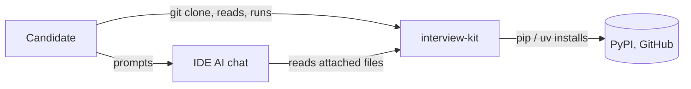

# interview-kit: system model (one page)

The small model the kit's own method asks for ([method/system-model.md](../../method/system-model.md)).
Elements have IDs; each is `decided` (true of the code now) or `guessed`.
Drift check: [tests/test_model.py](../../tests/test_model.py) (each writer below exists and writes
what this page says; `KIT.md` matches its sources).

## Elements

- G1 (decided): the goal in section 1.
- B1 (decided): notes, the method as markdown.
- B2 (decided): examples, runnable tested agent code.
- B3 (decided): check.sh, the enforcement gate.
- B4 (decided): practice problem, data, offline grader.
- B5 (decided): KIT.md, the generated bundle.
- P1 (decided): build the bundle.
- P2 (decided): install the pre-commit gate.
- P3 (decided): install AES at a pinned revision.
- P4 (decided): grade a practice solution.
- V1 (decided): KIT.md as a view of the notes.
- V2 (decided): check.sh output.
- V3 (decided): grade.py output.
- V4 (decided): wiki/index.md map.
- Q1 (decided): KIT.md equals a fresh build.
- Q2 (decided): an unfilled plan fails check.sh.
- Q3 (decided): the practice reference passes every case.
- Q4 (decided): every wiki link resolves.

## 1. Goals

Bring a working method (plan first, a small model, small checked steps, tests that could fail, a
review pass, a clear explanation) into a timed take-home test in a hosted IDE whose only allowed AI
is its recorded chat. Questions it answers: what do I do next; is my plan concrete; does my code
pass; am I done.

## 2. Context and scope

Inside: notes, examples, check scripts, practice problem. Outside: the IDE and its chat, package
hosts, the candidate's solution repo.

## 3. Building blocks

| ID | Block | Holds | Status |
|---|---|---|---|
| B1 | Notes: `AGENTS.md`, `PLAN.template.md`, `skills/`, `agents/`, `method/` | the method, as markdown | decided |
| B2 | `examples/` | runnable, tested agent code | decided |
| B3 | `check.sh` | the enforcement gate | decided |
| B4 | `practice/` | problem, data, offline grader, hidden reference | decided |
| B5 | `KIT.md` | generated bundle of B1 | decided |

The kit stores no state of its own. The candidate's repo holds `PLAN.md` and their solution.

## 4. Runtime: processes that write records

| ID | Process | Rule | Writes | Writer |
|---|---|---|---|---|
| P1 | build the bundle | concatenate notes in a fixed order | `KIT.md` | `build_kit.sh` |
| P2 | install the gate | check before every commit | `.git/hooks/pre-commit` in the candidate's repo | `check.sh` (`--install-hook`) |
| P3 | install AES | pin one AES revision | `aes` tool in the user's uv tools | `method/install_aes.sh` |
| P4 | grade practice | scripted model, fixed cases | nothing (prints) | `practice/grade.py` |

## 5. Cross-cutting: views

| ID | View | Shows |
|---|---|---|
| V1 | `KIT.md` | every note in B1 |
| V2 | `check.sh` output | plan concrete, code compiles, test counts, `--final` README sections |
| V3 | `grade.py` output | each practice case passed or failed |
| V4 | `wiki/index.md` | every part and decision |

## 6. Quality: expected observable patterns

| ID | Pattern | Where observable |
|---|---|---|
| Q1 | `KIT.md` equals a fresh `build_kit.sh` run | `tests/test_model.py` |
| Q2 | an unfilled plan template fails `check.sh` | `tests/test_check_sh.py` |
| Q3 | the practice reference scores every case | `tests/test_practice.py` |
| Q4 | every wiki link resolves | `tests/test_wiki_map.py` |

## Unknowns

| Unknown | What would decide it |
|---|---|
| Does a real test environment allow internet like the sandbox did? | the first real test's terminal: `git clone` works or not |
| Does the IDE chat read attached method files well? | a dry run in the IDE's chat with an account |
