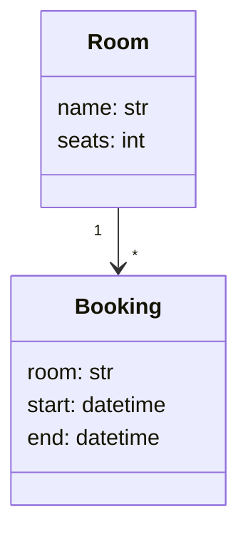
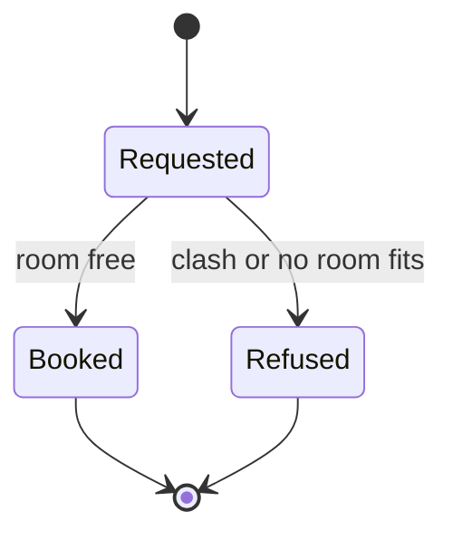

# System model: one page that says what the system is

Write one model per project before the code, and keep it true as the code changes. In a
take-home it is `docs/MODEL.md`, copied from `templates/MODEL.md` after `docs/PRD.md`, in the
Unified Process order (Larman: use cases, then the domain model, then interactions):

1. **Domain model**: the things in the use cases and the typed records, as a `classDiagram`,
   with a `Rules:` list of what must always be true.
2. **State machine**: the states a run or record moves through, with the human pause and the
   resume, as a `stateDiagram-v2`, and a `Forbidden:` list of transitions that must never happen.
3. **Sequence**: the riskiest use case (`## Sequence: UC2 <name>`), call by call.
4. **Tests from the model**: one row per state arrow, per forbidden line and per rule, each
   naming its test. The state machine is the test oracle (model-based testing).

`check.sh` enforces these. Add Context, Agent loop or Components only when they answer a
question; every diagram has a bold "Answer:" line under its heading. Only the state machine
may be replaced, by one line "No states: <reason>", when nothing changes state.

A long-lived project's model (like this repository's own) follows the arc42 headings, with C4
diagrams in Mermaid:

1. **Goals**: the outcome and the 2 to 4 quality goals that matter (correct refunds, bounded
   cost, explainable output).
2. **Context and scope**: who and what is outside the system, and what crosses the edge.
   One C4 context diagram.
3. **Building blocks**: the parts and what each owns. A table, one row per part.
4. **Processes**: each process (what triggers it, what it reads, what it writes, which function
   does the writing).
5. **Views**: which diagrams exist and what question each answers.
6. **Checks**: the observable pattern that shows each goal holds, and the test that checks it.

Never fill a gap with a guess presented as fact; mark each element `decided` or `guessed`.

## Keep it true

A model that drifts from the code is worse than none. Add one small test that reads the model
and checks it against the code in both directions: every row naming a function names one that
exists, and every tool or node in the code appears in the model. Break it once on purpose to see
it fail. This repository does that for itself: [docs/model/ARCHITECTURE.md](../docs/model/ARCHITECTURE.md)
and [tests/test_model.py](../tests/test_model.py).

## Example: a meeting-room booking agent

~~~markdown
## Domain model: what are the things, and what must always be true of them?
**Answer:** a booking joins one room to one time slot.

Rules:
- two bookings of one room never overlap

## State machine: what states does a booking request move through?
**Answer:** a request is checked, then booked or refused; nothing is written before the check.

Forbidden:
- Refused --> Booked

## Sequence: UC2 a clashing request is refused
(the riskiest use case: a double booking)

## Tests from the model
| Claim | From | Test |
|---|---|---|
| Requested --> Booked | state machine | `test_free_room_is_booked` |
| Requested --> Refused | state machine | `test_clash_is_refused_with_its_id` |
| Refused --> Booked | forbidden | `test_refused_request_writes_nothing` |
| two bookings never overlap | domain rule | `test_no_double_booking` |
~~~
