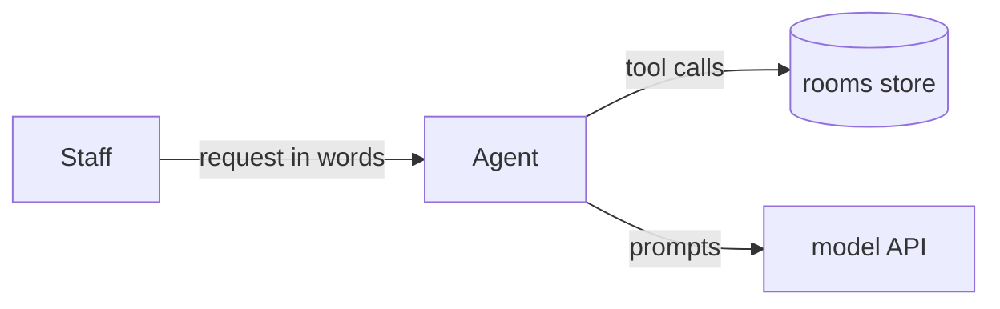

# System model: one page that says what the system is

Write one model per project before the code, and keep it true as the code changes. In a
take-home it is `docs/MODEL.md`, copied from `templates/MODEL.md`, with six diagrams (context,
building blocks, main sequence, rules, states, data) and the tables below; `check.sh` enforces
it. The content follows the arc42 headings, with C4 diagrams in Mermaid:

1. **Goals**: the outcome and the 2 to 4 quality goals that matter (correct refunds, bounded
   cost, explainable output).
2. **Context and scope**: who and what is outside the system, and what crosses the edge.
   One C4 context diagram.
3. **Building blocks**: the parts and what each owns. A table, one row per part.
4. **Runtime**: each process (what triggers it, what it reads, what it writes, which function
   does the writing). A table, plus one sequence diagram for the main path if it has more than
   three steps.
5. **Views**: which diagrams exist and what question each answers.
6. **Quality**: the observable pattern that shows each goal holds, and the test that checks it.

End with an **Unknowns** table: `| Unknown | What would decide it |`. Never fill a gap with a
guess presented as fact; mark each element `decided` or `guessed`.

A small system still gets all six diagrams; they are short. Only the states diagram may be
replaced, by one line "No states: <reason>", when nothing changes state.

## Keep it true

A model that drifts from the code is worse than none. Add one small test that reads the model
and checks it against the code in both directions: every runtime row names a function that
exists, and every tool or node in the code appears in the model. Break it once on purpose to see
it fail. This repository does that for itself: [docs/model/ARCHITECTURE.md](../docs/model/ARCHITECTURE.md)
and [tests/test_model.py](../tests/test_model.py).

## Example: a meeting-room booking agent

~~~markdown
## System model

Elements:
- G1 (decided): a staff member asks in plain words and gets a room booked or a clear reason why not.
- B1 (decided): agent graph; B2 (decided): rooms store; B3 (decided): calendar tool.
- P1 (decided): book_room writes a booking to the rooms store (`tools.py: book_room`).
- Q1 (decided): never double-books; test_no_double_booking.

### 1. Goals
Book a free room that fits the request; never double-book; explain each refusal.

### 2. Context

### 3. Building blocks
| Part | Owns |
|---|---|
| agent graph (`agent.py`) | the conversation and the stop rule |
| tools (`tools.py`) | find_rooms, book_room; all writes |
| rooms store (`rooms.json`) | rooms, bookings |

### 4. Runtime
| Process | Trigger | Reads | Writes | Writer |
|---|---|---|---|---|
| P1 book | model calls book_room | bookings | one booking | `tools.py: book_room` |

### 6. Quality
| Goal | Observable pattern | Check |
|---|---|---|
| never double-book | a second booking of the same slot is refused with the clashing id | `test_no_double_booking` |

### Unknowns
| Unknown | What would decide it |
|---|---|
| Are time zones in scope? | the task text, or the interviewer's answer |
~~~
