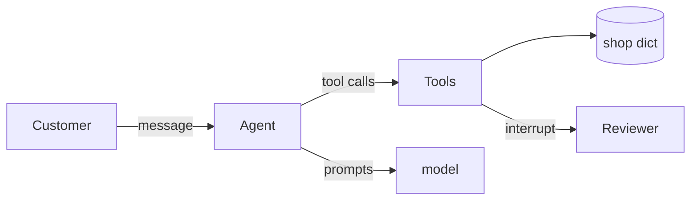

# Plan

## Goal
Build a small-shop support agent in `solution.py` (LangChain `create_agent` on LangGraph) that answers
one customer message with three tools over `kit/practice/data.json` and ends with a validated `Reply`.
Refunds over $50 pause for a human reviewer before any money moves.

Quoted requirements (kit/practice/PROBLEM.md):
- "`get_order(order_id)` ... Returns exactly `A-101: Desk lamp, $30, delivered 2026-02-20` (date only once delivered), or `Order A-999 not found.`"
- "`search_policy(query)` find the best matching policies, best first, at most 2 ... lines `P-2: <policy text>`, or `No matching policy.`"
- Refund rules in order: unknown, already refunded, not delivered, >30 days, >$50 needs approval (`yes` -> `Refunded X ($N) after approval.`, else `Refund for X declined by reviewer.`), else `Refunded X ($N).`
- "A refund is recorded by appending the order id to `shop["refunds"]`."
- "The final answer is a validated `Reply` ... An invalid answer goes back to the model to retry."
- "`def build_agent(llm, shop)` ... return a compiled graph with a checkpointer"

Shape: a bounded agent loop with tools (the next step depends on tool results). Not plain code:
the input is free text. Not a supervisor: one context suffices.

## Done when
- [x] `.venv/bin/python kit/practice/grade.py solution.py` -> `== grade: 8 passed, 0 failed`, exit 0 (ran: 8 passed, exit 0)
- [x] `.venv/bin/python -m pytest -v test_solution.py` -> all PASSED, none skipped (ran: 11 passed)
- [x] README explains approach, decisions, AI use and limitations

## Steps
1. Tools as pure functions over `shop` + unit tests (get_order, search_policy, refund rules 1-4, 6).
2. `Reply` Pydantic model with validation + tests for a bad order id / bad category.
3. `build_agent`: `create_agent(llm, tools, response_format=ToolStrategy(Reply), checkpointer=InMemorySaver())`; approval via `interrupt()` inside `request_refund`, side effect after it returns.
4. Run grader; read every failure trace; fix.
5. README, tick plan, `bash kit/check.sh --final`.

## System model

Elements:
- G1 (decided): customer message -> correct tool outputs and a validated Reply; refunds only when rules allow.
- B1 (decided): agent graph (`build_agent`); B2 (decided): tools (`make_tools`); B3 (decided): `shop` dict (given by caller).
- P1 (decided): refund writes `shop["refunds"]` (`solution.py: make_tools.request_refund`).
- Q1 (decided): no refund over $50 without a "yes"; `test_big_refund_needs_yes`.

### 1. Goals
Correct refund decisions (rule order exact); never refund >$50 without approval; output always a valid Reply.

### 2. Context

### 3. Building blocks
| Part | Owns |
|---|---|
| `build_agent` | wiring: model, tools, Reply schema, checkpointer, step bound |
| `make_tools(shop)` | get_order, search_policy, request_refund; the only writer |
| `Reply` | final answer schema and its validation |

### 4. Runtime
| Process | Trigger | Reads | Writes | Writer |
|---|---|---|---|---|
| P1 refund | model calls request_refund | orders, refunds, today | append to refunds | `make_tools.request_refund` |
| P2 approval | refund > $50 | reviewer answer via resume | nothing (gates P1) | `interrupt()` in request_refund |

### 5. Views
Context diagram above: what crosses the system edge.

### 6. Quality
| Goal | Observable pattern | Check |
|---|---|---|
| rule order | already-refunded beats not-delivered etc. | `test_refund_rules_*` |
| approval gate | refunds list empty until "yes" | `test_big_refund_needs_yes`, grader |
| valid Reply | bad order id rejected | `test_reply_rejects_bad_id` |

### Unknowns
| Unknown | What would decide it |
|---|---|
| Policy match scoring (guessed: keyword overlap) | grader cases |
| "more than 30 days" boundary: 30 days allowed (guessed) | grader cases |

## Assumptions
- "Delivered more than 30 days" -> days = today - delivered_on; refuse when > 30.
- Over $50 means amount > 50 (exactly $50 refunds without approval).
- Reviewer answer other than exactly "yes" (case-insensitive) is a decline.

## Risks
- interrupt() inside a tool re-runs the tool on resume -> refund must happen only after interrupt returns; a double append would show in the grader's refunds list.
- Policy ranking differing from the grader's -> shows as tool_output_contains failures.
