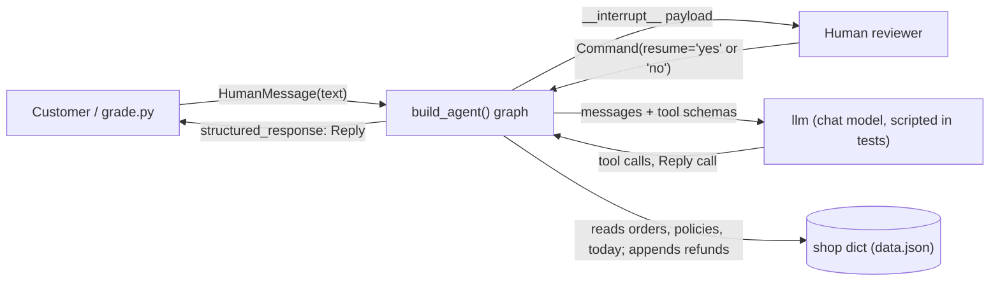
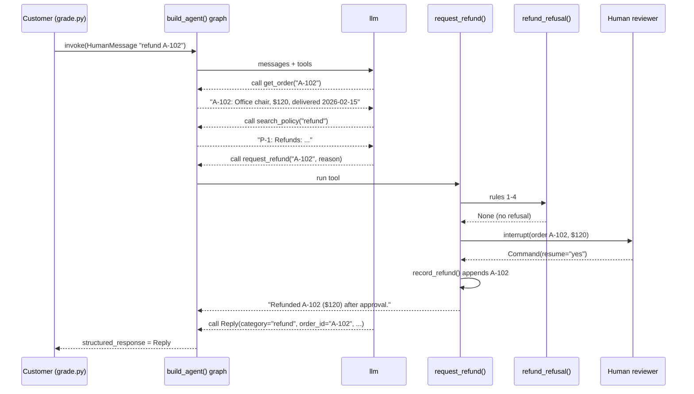

# Order-support agent (practice take-home)

## Run it
`.venv/bin/python kit/practice/grade.py solution.py`  ->  `== grade: 8 passed, 0 failed of 8 cases` (exit 0)

Tests: `.venv/bin/python -m pytest -v test_solution.py`  ->  `8 passed` (offline, scripted fake model, no API key)

Setup: `uv venv && uv pip install langchain langgraph pytest`.

## Approach
A customer message goes into a LangChain `create_agent` loop with three tools bound to this run's
`shop` (`get_order`, `search_policy`, `request_refund`). Refund rules 1-4 live in one pure function,
`refund_refusal()`; a refund over $50 pauses with `interrupt()` inside the tool until a reviewer
resumes with `yes` or anything else. The final answer is a Pydantic `Reply` offered to the model as a
tool through `ToolStrategy`, so an invalid answer goes back to the model to retry.

`START -> model -> tools -> model ... -> Reply -> END` (with a checkpointer and a 25-step limit).

## Design decisions
The three that matter most (all seven are in [docs/DECISIONS.md](docs/DECISIONS.md)):
1. Prebuilt `create_agent` with `ToolStrategy(Reply)` and `InMemorySaver`, not a hand-built graph:
   it already gives retry-on-invalid and `structured_response`.
2. The approval `interrupt()` sits inside `request_refund`, after rules 1-4 and before the only
   write, `record_refund()`. LangGraph re-runs the tool from the top on resume, so nothing is
   written before the pause; a test checks the id is recorded exactly once.
3. Policy search is keyword overlap with light stemming (3 short policies; offline and explainable);
   ties keep data order. Embeddings were rejected as needing a key or a model download.

Design, model and all six diagrams: [docs/DESIGN.md](docs/DESIGN.md), [docs/MODEL.md](docs/MODEL.md).

Context:

Main sequence (refund over $50, approved):

| Requirement | Code | Test |
|---|---|---|
| R1 "`get_order(order_id)` ... `A-101: Desk lamp, $30, delivered 2026-02-20` (date only once delivered), or `Order A-999 not found.`" | `get_order()`, `format_order()` | `test_get_order_formats` |
| R2 "`search_policy(query)` ... best first, at most 2 ... or `No matching policy.`" | `search_policy()`, `score_policy()` | `test_search_policy_ranks_best_first` |
| R3-R6 "Refund rules, checked in this order" (not found, already refunded, not delivered, over 30 days) | `refund_refusal()`, `days_since_delivery()` | `test_refund_rules_in_order` |
| R7 "Amount over $50: pause and ask a human reviewer, before refunding" | `request_refund()` (`interrupt()`) | `test_large_refund_approved_after_pause`, `test_large_refund_declined_records_nothing` |
| R8 "Otherwise: `Refunded X ($N).`" | `request_refund()` | `test_small_refund_recorded_once` |
| R9 "A refund is recorded by appending the order id to `shop[\"refunds\"]`." | `record_refund()` | `test_small_refund_recorded_once` |
| R10 "The final answer is a validated `Reply` ... An invalid answer goes back to the model to retry." | `Reply`, `ToolStrategy(Reply)` in `build_agent()` | `test_invalid_reply_is_retried`, `test_reply_rejects_bad_fields` |
| R11 "`build_agent(llm, shop)` ... a compiled graph with a checkpointer" | `build_agent()` | all agent tests and `kit/practice/grade.py` |

## Assumptions
- "More than 30 days" means days > 30; exactly 30 is refundable (tested at 30 and 31).
- "Over $50" means amount > 50.
- Only `yes` (trimmed, any case) approves; "Otherwise" covers every other resume value.
- `Reply.order_id` is `A-123` or null; `action` must be one sentence (a second sentence is rejected
  so the model retries); `policy_ids` look like `P-1`.
- Order ids are upper-cased and trimmed before lookup.
- A not-delivered order shows its status word without a date: `A-103: Monitor, $80, processing`.

## How I used the AI assistant
This was a solo rehearsal: the AI assistant (Claude) did the whole build, working from the kit's
files only.
- Delegated: everything, in the kit's order: plan and planning package first, then the code, tests,
  grading and this README.
- Kept to the kit's design rules: the rule order lives in one function; the write happens after the
  approval pause, following the kit's watchlist note that `interrupt()` inside a tool re-runs the
  tool on resume.
- Where it deviated: it wrote `solution.py` in one edit and the tests right after, rather than one
  test-first step at a time as `AGENTS.md` asks; all 8 tests and all 8 grader cases passed on the
  first run. It then read the retry trace to check the invalid `Reply` really was rejected and
  retried, not just that the final answer looked right, and added that check to the test.
- Corrections: the Mermaid render step first failed (mermaid-cli could not find its Chrome build); it
  was pointed at an installed headless Chrome with a puppeteer config, and all six diagrams rendered.

## Limitations and next steps
- Policy search is keyword overlap; a paraphrase with no shared words ("money back") finds nothing.
  Next: embeddings, or have the model pass a category to search by.
- The one-sentence check on `action` is a punctuation rule; "e.g. this" would count as two sentences.
- Refunds live in the in-memory `shop` dict and the checkpointer is in memory; a restart loses both.
- No live model was run (no key given); only the scripted fake model and the grader's script.
- Step limit 25 is a guess at headroom; not tuned against a real model.
