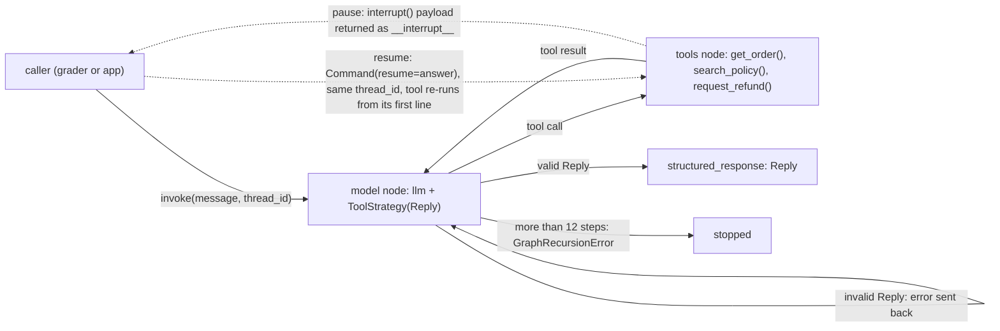

# Order-support agent (practice run)

## Run it
`.venv/bin/python kit/practice/grade.py solution.py`  ->  `== grade: 8 passed, 0 failed of 8 cases` (offline, scripted model)
Tests: `.venv/bin/python -m pytest -v test_solution.py`  ->  `9 passed`
Pause/resume probe: `.venv/bin/python probe_interrupt.py`  ->  shows the pause payload returned to the caller and the tool entered twice.
Setup: `uv venv && uv pip install langchain langgraph pytest` (a live run also needs `langchain-openai` and `OPENAI_API_KEY`; `make_llm()` fails with a clear message without it).

## Approach
A bounded agent loop built with `create_agent`: START -> model -> tools -> model ... -> `Reply` -> END.
Three tools are closures over the caller's `shop` dict; all six refund rules live in plain Python in
`request_refund()`, and refunds over $50 pause with `interrupt()` before the only write. The final
answer is a Pydantic `Reply` registered with `ToolStrategy`, so an invalid answer goes back to the
model as an error and it retries.

## Design decisions
The ones that matter most (all of them: [docs/DECISIONS.md](docs/DECISIONS.md); design, model and
all six diagrams: [docs/DESIGN.md](docs/DESIGN.md), [docs/MODEL.md](docs/MODEL.md)):

- **Pause inside the tool, write after it.** LangGraph's `interrupt()` returns the payload to the
  caller; on `Command(resume=...)` with the same `thread_id` the tool runs again from its first line.
  So the rule checks run twice (read only) and the single append happens after `interrupt()`
  returns "yes". Verified by running `probe_interrupt.py`, and by
  `test_large_refund_pauses_then_approves` (refund recorded once).
- **`create_agent` + `ToolStrategy(Reply)`** rather than a hand-built graph: the scripted model
  answers by calling a tool named `Reply`, which is exactly what ToolStrategy registers.
- **Step limit travels with the graph** (`recursion_limit` 12 set in `build_agent()`), since the
  caller owns `invoke`.

Agent loop (diagram 2 of the model):

Refund rules (diagram 4 of the model), first match wins:

| # | Check (first match wins) | Result text | Code |
|---|---|---|---|
| 1 | order id not in `shop["orders"]` | `Order X not found.` | `request_refund()` |
| 2 | order id already in `shop["refunds"]` | `X was already refunded.` | `request_refund()` |
| 3 | status is not `delivered` | `Not eligible: X has not been delivered.` | `request_refund()` |
| 4 | `today - delivered_on` > 30 days | `Not eligible: X was delivered N days ago (limit 30).` | `request_refund()` |
| 5 | amount > $50 | pause via `interrupt()`; then `Refunded X ($N) after approval.` or `Refund for X declined by reviewer.` | `request_refund()` |
| 6 | otherwise | `Refunded X ($N).` | `request_refund()` |

| Requirement | Code | Test |
|---|---|---|
| R1 "`get_order(order_id)` ... or `Order A-999 not found.`" | `get_order()` | `test_get_order_delivered_and_missing` |
| R2 "best matching policies, best first, at most 2" | `search_policy()` | `test_search_policy_best_first_and_no_match` |
| R3 "Refund rules, checked in this order" | `request_refund()` | `test_refund_rules_in_order` |
| R4 "Amount over $50: pause and ask a human reviewer, before refunding." | `request_refund()` + `interrupt()` | `test_large_refund_pauses_then_approves`, `test_large_refund_declined_records_nothing` |
| R5 "appending the order id to `shop["refunds"]`" | `request_refund()` | `test_agent_end_to_end_small_refund` |
| R6 "An invalid answer goes back to the model to retry." | `Reply` + `ToolStrategy` | `test_reply_rejects_bad_values`, `test_invalid_reply_goes_back_for_retry` |
| R7 "a compiled graph with a checkpointer" | `build_agent()` | grader cases with pauses |

## Assumptions
- Exactly 30 days after delivery is still refundable (`days > 30` is the cut-off).
- Exactly $50 refunds without review ("over $50" read as strictly greater).
- Only the reviewer answer "yes" (any case, trimmed) approves; anything else declines.
- A not-yet-delivered order shows its status: `A-103: Monitor, $80, processing`.
- Policy match = count of shared content words; ties keep policy order; no shared words = `No matching policy.`

## How I used the AI assistant
This run was done by an AI agent (Claude) rehearsing the kit end to end, so "the AI" wrote the code.
What kept it honest was running things, not trusting recall:
- The interrupt/resume mechanism was checked by running `probe_interrupt.py` before drawing
  diagrams 2, 3 and 5. The run showed the tool is entered twice (`risky() entered 2 times`), which
  is why the append sits after `interrupt()`; writing it before would double-refund.
- The "invalid Reply goes back" claim was checked by printing the messages: the first `Reply` with
  `category="billing"` came back as an `Error: Failed to parse structured output ...` tool message,
  and the test now asserts that message exists.
- The step limit was checked with a model that loops forever; with the limit it raises
  `GraphRecursionError`, without it the fake model would run out of messages instead.

## Limitations and next steps
- Never run against a live model; tool choice from the docstrings is untested with a real LLM.
- Policy search is word overlap; a synonym ("money back" for refund) finds nothing.
- The checkpointer is in memory, so a paused refund is lost if the process restarts; use a
  persistent saver (SQLite/Postgres) for real use.
- Concurrent resumes of two threads refunding the same order are not guarded.
