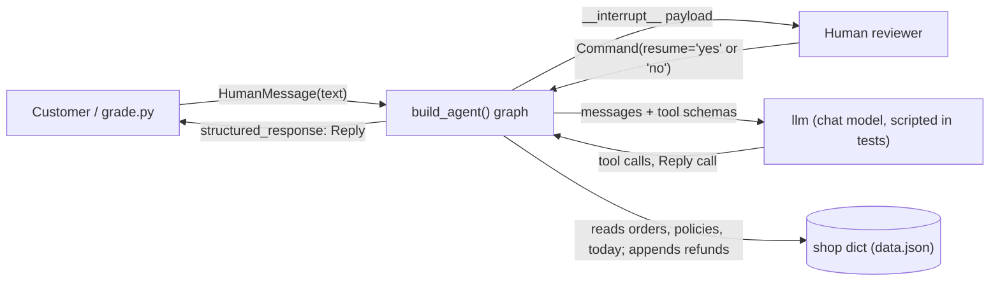
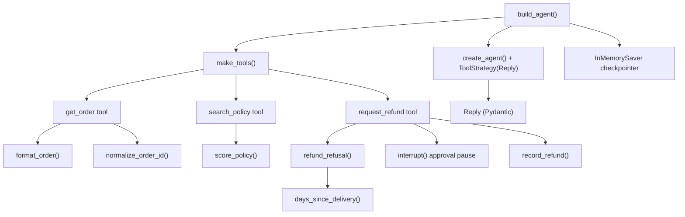
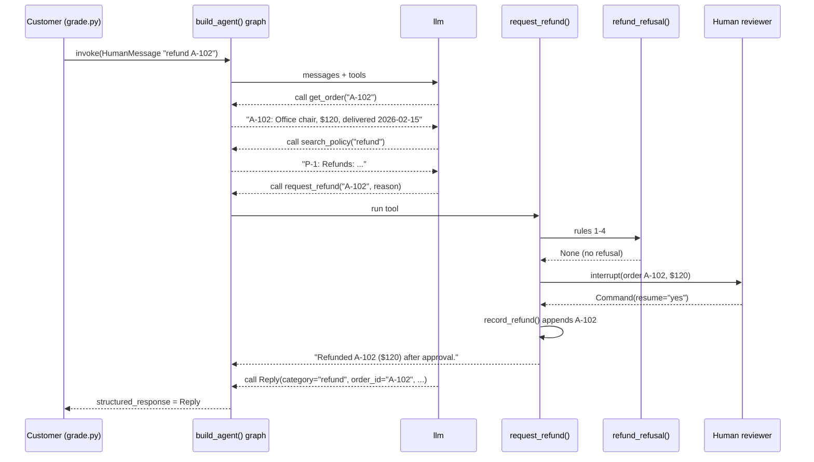
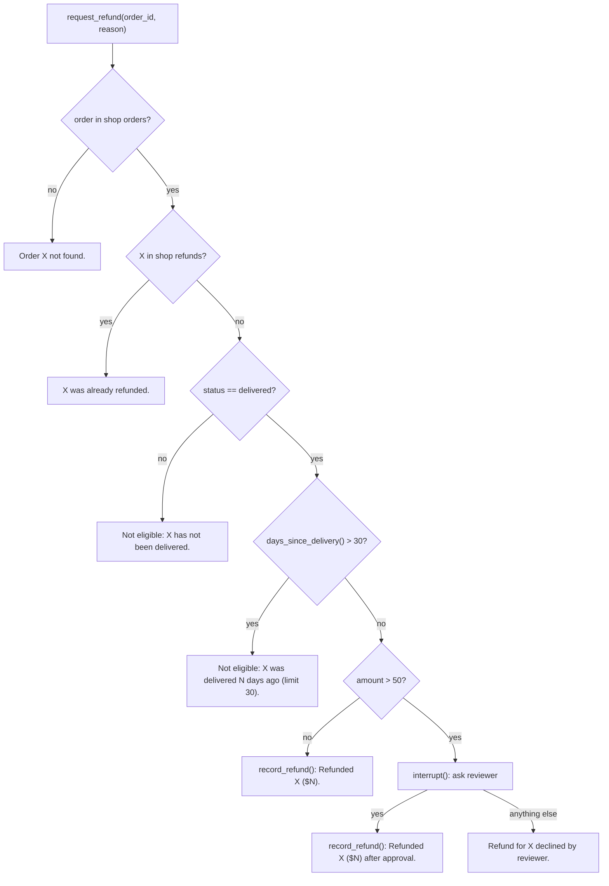
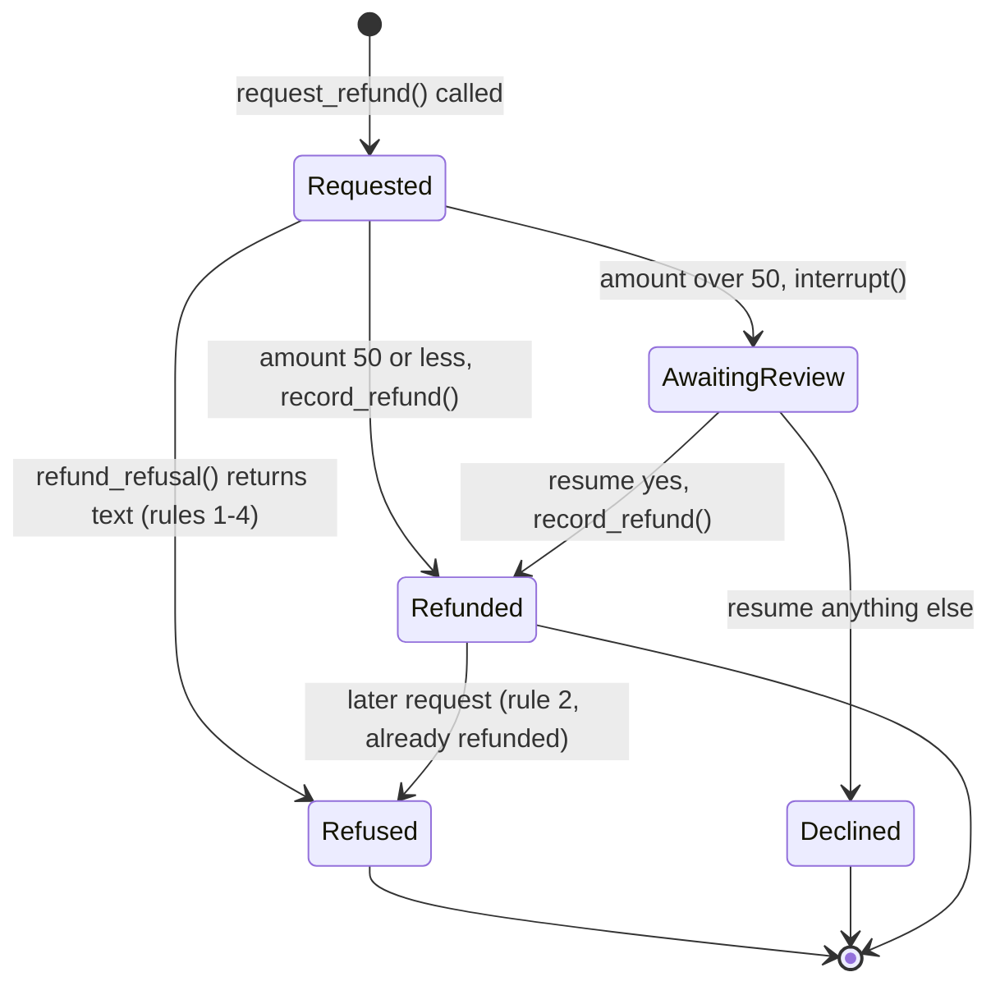
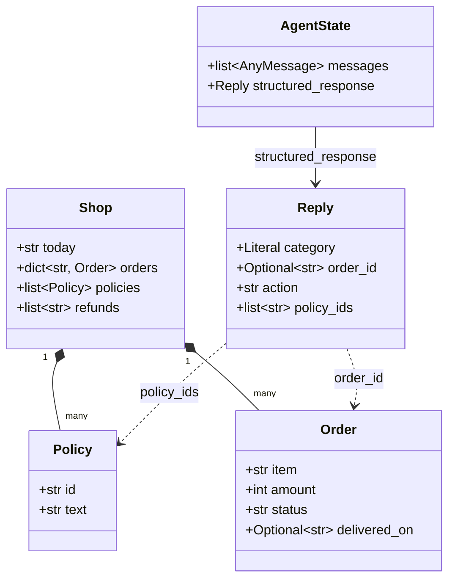

# System model

Filled from `kit/templates/MODEL.md` before the code; kept true as the code changes. Every box
names a real function, tool, class or record in `solution.py` (or the library class it uses).
All elements are decided unless marked (guessed).

## Goals
- Outcome: a shop customer sends one message and receives a validated `Reply`; allowed refunds are recorded in `shop["refunds"]`, and refunds over $50 wait for a reviewer's `yes`.
- Quality goals: correct refunds (right rule, right order, never twice); exact tool output strings; bounded steps; a final answer that always validates.

## 1. Context: who and what is outside the system?

## 2. Building blocks: which part owns what?

| Block | Owns | Code |
|---|---|---|
| Graph builder | wiring: model, tools, `Reply` schema, checkpointer, step limit | `build_agent()` |
| Tool factory | binds the three tools to this run's `shop` | `make_tools()` |
| Order lookup | exact order line or not-found text | `get_order()`, `format_order()`, `normalize_order_id()` |
| Policy search | ranking, at most 2, no-match text | `search_policy()`, `score_policy()` |
| Refund rules 1-4 | refusal text, in order | `refund_refusal()`, `days_since_delivery()` |
| Refund action | approval pause over $50, the only write | `request_refund()`, `record_refund()` |
| Final answer | validation of category, order id, action, policy ids | `Reply` |
| Step log | one log line per tool call | `log_step()` |

## 3. Main sequence: what happens, in order, on the main path?
Refund over $50 that the reviewer approves (order A-102, $120).

## 4. Rules: in what order are the business rules checked?

## 5. States: what states does the main item move through?
The main item is one refund request for one order.

## 6. Data: what are the typed contracts and state?

`Shop`, `Order`, `Policy` are `TypedDict`s and `Reply` is a Pydantic model in `solution.py`;
`AgentState` is LangChain's `create_agent` state.

## Runtime: which function writes each record?
| Process | Trigger | Reads | Writes | Writer |
|---|---|---|---|---|
| Look up order | model calls `get_order` | `shop["orders"]`, `shop["today"]` | nothing | `get_order()` |
| Search policies | model calls `search_policy` | `shop["policies"]` | nothing | `search_policy()` |
| Refund | model calls `request_refund`; resumed by `Command(resume=...)` | orders, refunds, today | appends to `shop["refunds"]` | `record_refund()` |
| Pause for review | refund passes rules 1-4 and amount > 50 | order | checkpoint (thread state) | `request_refund()` via LangGraph `interrupt` |
| Final answer | model calls `Reply` | tool results | `structured_response` | `create_agent` `ToolStrategy(Reply)` |

## Contracts: what crosses between parts, and how it fails
| Crossing | Producer | Consumer | Shape | On failure |
|---|---|---|---|---|
| customer -> graph | grader | `build_agent()` graph | `{"messages": [HumanMessage]}`, config with `thread_id` | missing `thread_id`: checkpointer raises |
| model -> tools | llm | `get_order()`, `search_policy()`, `request_refund()` | typed tool args (`order_id: str`, `query: str`, `reason: str`) | bad args: `ToolNode` returns the error to the model |
| tools -> model | tools | llm | exact strings from the task | unknown order: the not-found text, not an exception |
| graph -> reviewer | `request_refund()` | caller | `__interrupt__` with `{"order_id", "amount", "question"}` | no resume: run stays paused on that thread |
| reviewer -> graph | caller | `request_refund()` | `Command(resume="yes" or other)` | anything but `yes` declines |
| model -> answer | llm | `Reply` | `category`, `order_id`, `action`, `policy_ids` | `ValidationError` text sent back, model retries |

## Quality: what observable result shows each goal holds?
| Goal | Observable pattern | Test |
|---|---|---|
| exact tool strings | delivered order shows date; processing order does not; unknown id gives not-found | `test_get_order_formats` |
| policies best first, at most 2 | a shipping query returns P-2 first, never 3 lines; nonsense returns `No matching policy.` | `test_search_policy_ranks_best_first` |
| rules in order | old + over $50 order is refused without a pause; repeat refund says already refunded | `test_refund_rules_in_order` |
| never refund twice | `shop["refunds"]` holds the id exactly once after a resumed approval | `test_large_refund_approved_after_pause` |
| decline records nothing | resume `no` leaves `shop["refunds"]` empty | `test_large_refund_declined_records_nothing` |
| small refund | $30 order refunded without pause | `test_small_refund_recorded_once` |
| answer always validates | an invalid `Reply` is retried and the second one is returned | `test_invalid_reply_is_retried` |

## Unknowns
| Unknown | What would decide it |
|---|---|
| Exact ranking the grader expects for policy search (guessed: keyword overlap) | the first grade run's `tool_output_contains` and `policy_ids` results |
| Whether the scripted model sends `order_id: null` or the string `"none"` for no order (guessed: null) | the first grade run |
| Whether "one sentence" is checked by the grader (guessed: no, enforced only by `Reply`) | the first grade run |
