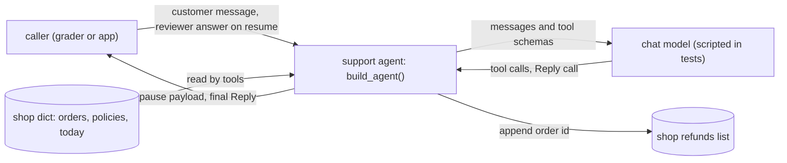
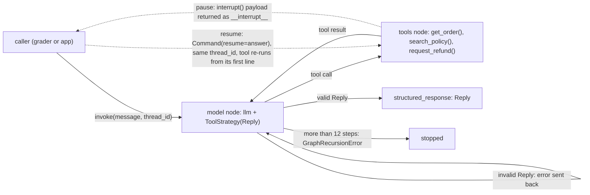
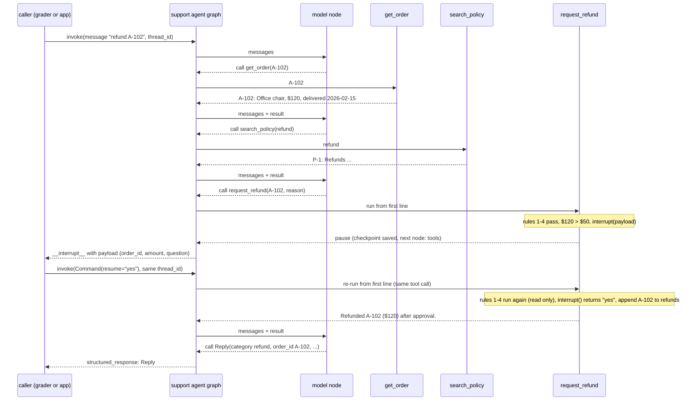
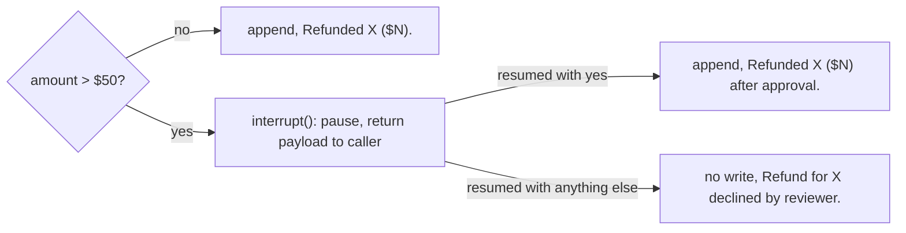
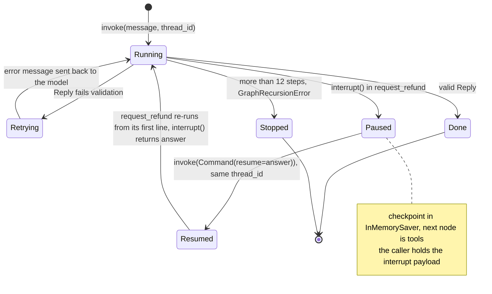
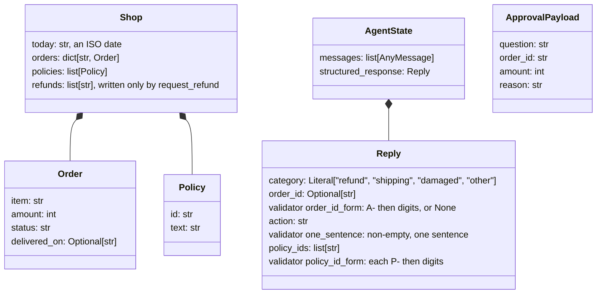

# System model: order-support agent, answers one customer message with three tools and a validated Reply; its key choice is that the approval pause is `interrupt()` inside `request_refund()`, before the only write

Kept true to the code in `solution.py`. Every box, arrow and row names a real function, class,
tool or record. The pause/resume behavior drawn in diagrams 2, 3 and 5 was observed by running
`probe_interrupt.py` (langgraph 1.2.14, langchain 1.4.4), not taken from memory: the first
`invoke` returns `__interrupt__` to the caller with the payload, the checkpoint's next node is
`tools`, and `invoke(Command(resume="yes"))` on the same `thread_id` enters the tool a second
time from its first line, where `interrupt()` now returns `"yes"`.

## Goals
- Outcome: a customer sends one message and gets a validated `Reply`; refunds happen only when the six rules allow, and over $50 only after a human says yes.
- Quality goals: correct refunds (right text, recorded exactly once), human approval before any refund over $50, bounded steps, every final answer validated.

## 1. Context: who and what is outside the system?
**Answer:** a caller (the grader or an app) sends the customer message and the reviewer's answer; the agent reads the shop data and calls a chat model, and it writes only `shop["refunds"]`.
*View: current. Arrows mean: data sent across the system edge.*

## 2. Agent loop: which part runs each step, and where does the run stop or pause?
**Answer:** the model node picks the next tool or the final `Reply`, the tools node runs it, and the run stops at a valid `Reply` or the 12-step limit, or pauses inside `request_refund()` and returns to the caller until it resumes.
*View: current. Arrows mean: control passes to the next part to run (dotted: the run leaves or re-enters the graph).*

Who owns what (one row per part; mark the only writer of each record):

| Block | Owns | Code |
|---|---|---|
| support agent | wiring, step limit (12), checkpointer | `build_agent()` |
| model node | choosing the next tool or the final answer; validating `Reply` and sending errors back | `create_agent()` with `ToolStrategy()` |
| tools node | running the three tools for this shop | `make_tools()` |
| order lookup | order text | `get_order()` |
| policy search | ranking policies, at most 2 | `search_policy()` |
| refund rules | the six rules and the pause; **only writer** of `shop["refunds"]` | `request_refund()` |
| checkpointer | the paused run, keyed by `thread_id` | `InMemorySaver()` |

## 3. Main sequence: what happens, in order, on the main path?
**Answer:** for a $120 refund the run looks up the order and policy, pauses inside `request_refund()` and returns the payload to the caller; the caller resumes on the same thread, the tool re-runs from its first line, refunds once, and the model ends with a `Reply`.
*View: current, as observed with `probe_interrupt.py` and `test_large_refund_pauses_then_approves`. Arrows mean: `->>` a call, `-->>` its return.*

## 4. Rules: in what order are the business rules checked?
**Answer:** `request_refund()` checks unknown, already refunded, not delivered, older than 30 days, over $50, then refunds; the first match wins and only the last two write.
*View: current. Arrows mean: the answer to the gate leads to that outcome.*
| # | Check (first match wins) | Result text | Code |
|---|---|---|---|
| 1 | order id not in `shop["orders"]` | `Order X not found.` | `request_refund()` |
| 2 | order id already in `shop["refunds"]` | `X was already refunded.` | `request_refund()` |
| 3 | status is not `delivered` | `Not eligible: X has not been delivered.` | `request_refund()` |
| 4 | `today - delivered_on` > 30 days | `Not eligible: X was delivered N days ago (limit 30).` | `request_refund()` |
| 5 | amount > $50 | pause via `interrupt()`; then `Refunded X ($N) after approval.` or `Refund for X declined by reviewer.` | `request_refund()` |
| 6 | otherwise | `Refunded X ($N).` | `request_refund()` |

Rules 1 to 4 and 6 are a straight chain (table); only rule 5 branches:

## 5. States: what states does a run or record move through, including pauses and resumes?
**Answer:** a run on one `thread_id` is running, paused (checkpointed with the tools node next) until the caller resumes it, re-runs the interrupted tool from its start, and ends with a `Reply` or stops at the step limit; an invalid `Reply` sends it back to the model to retry.
*View: current, as observed with `probe_interrupt.py`. Arrows mean: the event that moves the run to the next state.*

## 6. Data: what are the typed contracts and state?
**Answer:** the model must end with a `Reply` (four validated fields); tools read the `shop` dict and `request_refund()` appends to its refunds list; the pause carries an approval payload.
*View: current. Arrows mean: "contains". ApprovalPayload is not stored in state; it is the value of `__interrupt__` returned to the caller.*

## Runtime: which function writes each record?
| Process | Trigger | Reads | Writes | Writer |
|---|---|---|---|---|
| answer a message | caller invokes with a message and `thread_id` | messages | messages, checkpoint | `build_agent()` graph |
| look up order | model calls `get_order` | `shop["orders"]` | nothing | `get_order()` |
| search policies | model calls `search_policy` | `shop["policies"]` | nothing | `search_policy()` |
| refund | model calls `request_refund` | orders, refunds, today | `shop["refunds"]` (one append) | `request_refund()` |
| pause for approval | amount > $50 | order, amount | checkpoint (next node tools) | `interrupt()` |
| final answer | model calls `Reply` | the call's arguments | `structured_response` | `create_agent()` with `ToolStrategy()` |

## Contracts: what crosses between parts, and how it fails
| Crossing | Producer | Consumer | Shape | On failure |
|---|---|---|---|---|
| tool call | model node | tools node | name + typed args | unknown order id -> `Order X not found.` text, not an exception |
| tool result | tools | model node | one short string (exact texts in diagram 4) | n/a |
| final answer | model node | caller | `Reply` (Pydantic) | validation error text sent back to the model, which retries |
| pause | `request_refund()` | caller | `__interrupt__` with payload `ApprovalPayload` | caller must resume on the same `thread_id`; any answer but "yes" declines |
| resume | caller | `request_refund()` | `Command(resume=str)` | `Command(resume=None)` crashes in langgraph 1.2.14, so callers send "no" |

## Quality: what observable result shows each goal holds?
| Goal | Observable pattern | Test |
|---|---|---|
| correct refunds | each rule's exact text, in the stated order | `test_refund_rules_in_order` |
| approval before any refund over $50 | one pause; refunds list has the id once after "yes", empty after "no" | `test_large_refund_pauses_then_approves`, `test_large_refund_declined_records_nothing` |
| validated final answer | a bad category is rejected and retried | `test_reply_rejects_bad_values`, `test_invalid_reply_goes_back_for_retry` |
| bounded steps | a model that never answers stops with `GraphRecursionError` | `test_looping_model_is_stopped` |
| tools and wiring | order text, policy ranking, end-to-end refund | `test_get_order_delivered_and_missing`, `test_search_policy_best_first_and_no_match`, `test_agent_end_to_end_small_refund` |

## Unknowns
| Unknown | What would decide it |
|---|---|
| Is exactly 30 days still refundable? (chosen: yes) | the task owner's answer, or a grader case on day 30 |
| Is exactly $50 refunded without review? (chosen: yes) | the task owner's answer |
| Does a live model pick the right tools from these docstrings? (guessed: yes) | a run with a real key on the grader messages |
