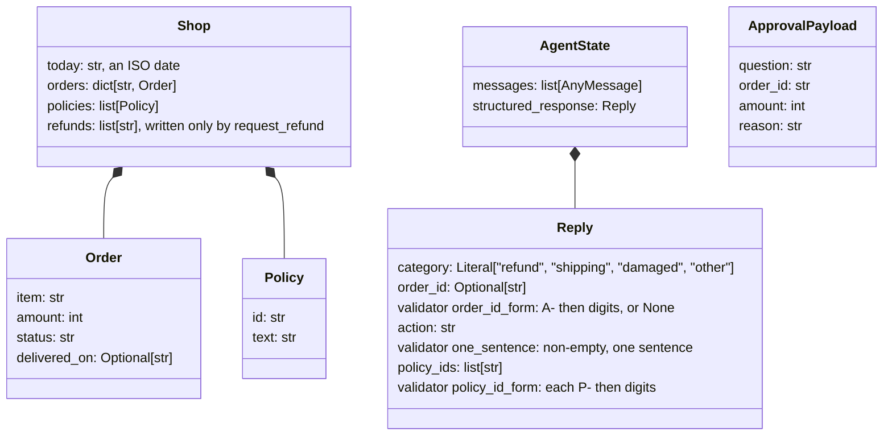
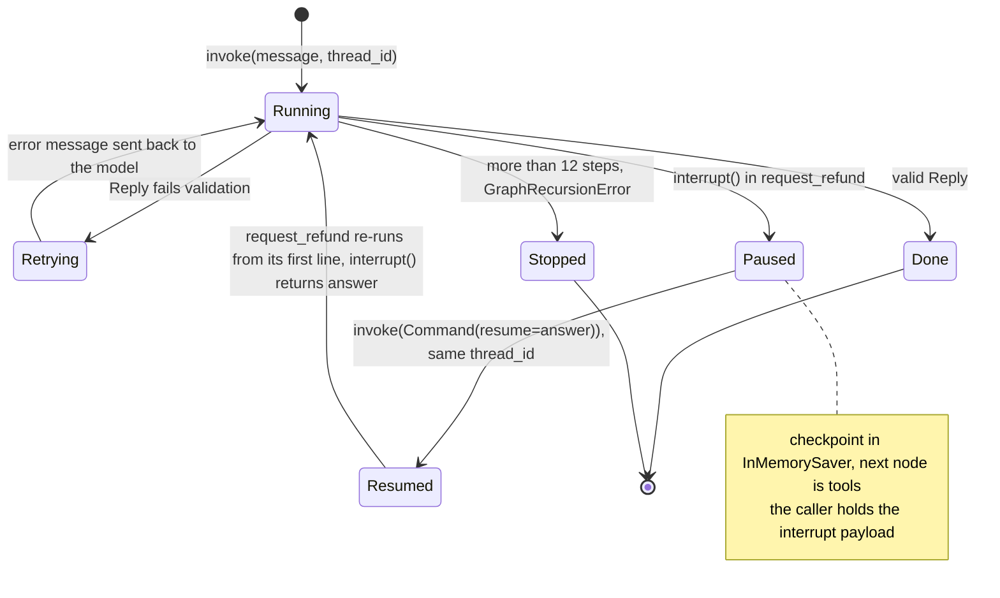
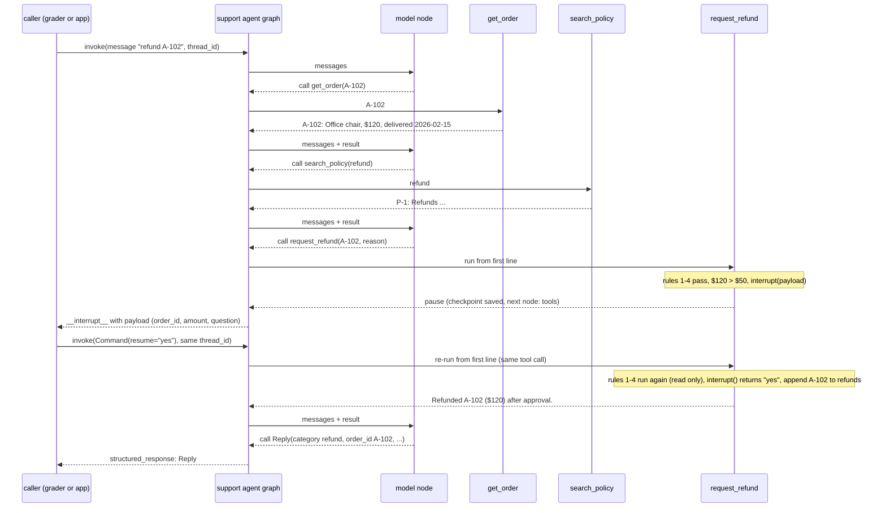
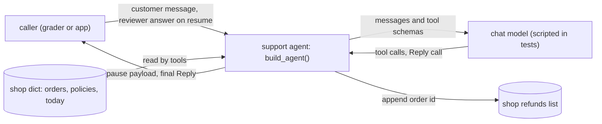
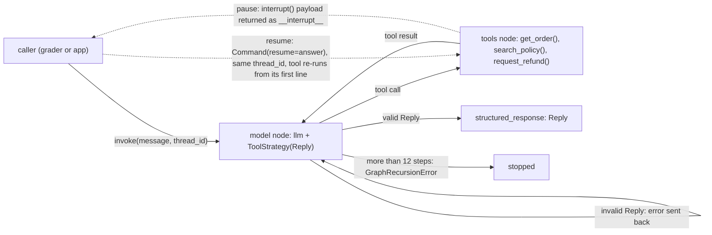

# System model: order-support agent, answers one customer message with three tools and a validated Reply; its key choice is that the approval pause is `interrupt()` inside `request_refund()`, before the only write

Kept true to the code in `solution.py`. Every box, arrow and row names a real function, class,
tool or record. The pause/resume behavior drawn in the state machine, the sequence and the agent loop was observed by running
`probe_interrupt.py` (langgraph 1.2.14, langchain 1.4.4), not taken from memory: the first
`invoke` returns `__interrupt__` to the caller with the payload, the checkpoint's next node is
`tools`, and `invoke(Command(resume="yes"))` on the same `thread_id` enters the tool a second
time from its first line, where `interrupt()` now returns `"yes"`.
Diagrams are drawn only where they answer a question; the row ids (UC2, K1) point at docs/PRD.md.

## Domain model: what are the things, and what must always be true of them?
**Answer:** the model must end with a `Reply` (four validated fields); tools read the `shop` dict and `request_refund()` appends to its refunds list; the pause carries an approval payload.
*View: current. Arrows mean: "contains". ApprovalPayload is not stored in state; it is the value of `__interrupt__` returned to the caller.*

Rules (checked in this order by `request_refund()`, first match wins; only 5 and 6 write):
1. order id not in `shop["orders"]`: `Order X not found.`
2. order id already in `shop["refunds"]`: `X was already refunded.`
3. status is not `delivered`: `Not eligible: X has not been delivered.`
4. `today - delivered_on` > 30 days: `Not eligible: X was delivered N days ago (limit 30).`
5. amount > $50: pause via `interrupt()`; then `Refunded X ($N) after approval.` or `Refund for X declined by reviewer.`
6. otherwise: `Refunded X ($N).`
7. `shop["refunds"]` holds each order id at most once, and only `request_refund()` appends to it.

## State machine: what states does a run move through, including the pause, and what is forbidden?
**Answer:** a run on one `thread_id` is running, paused (checkpointed with the tools node next) until the caller resumes it, re-runs the interrupted tool from its start, and ends with a `Reply` or stops at the step limit; an invalid `Reply` sends it back to the model to retry.
*View: current, as observed with `probe_interrupt.py`. Arrows mean: the event that moves the run to the next state.*

Forbidden:
- Paused --> Done
- Paused --> Running

A paused run never ends, and never goes back to the model, without the reviewer's answer: it must
pass through Resumed, where `request_refund()` re-runs from its first line.

## Sequence: UC2 refund over $50, approved (the riskiest use case, K1)
**Answer:** for a $120 refund the run looks up the order and policy, pauses inside `request_refund()` and returns the payload to the caller; the caller resumes on the same thread, the tool re-runs from its first line, refunds once, and the model ends with a `Reply`.
*View: current, as observed with `probe_interrupt.py` and `test_large_refund_pauses_then_approves`. Arrows mean: `->>` a call, `-->>` its return.*

## Tests from the model
| Claim | From | Test |
|---|---|---|
| [*] --> Running | state machine | `test_agent_end_to_end_small_refund` |
| Running --> Retrying | state machine | `test_invalid_reply_goes_back_for_retry` |
| Retrying --> Running | state machine | `test_invalid_reply_goes_back_for_retry` |
| Running --> Paused | state machine | `test_large_refund_pauses_then_approves` |
| Paused --> Resumed | state machine | `test_large_refund_pauses_then_approves`, `test_large_refund_declined_records_nothing` |
| Resumed --> Running | state machine | `test_large_refund_pauses_then_approves` |
| Running --> Done | state machine | `test_agent_end_to_end_small_refund` |
| Running --> Stopped | state machine | `test_looping_model_is_stopped` |
| Done --> [*] | state machine | `test_agent_end_to_end_small_refund` |
| Stopped --> [*] | state machine | `test_looping_model_is_stopped` |
| Paused --> Done is forbidden: one pause, then the reviewer's answer, then the Reply | forbidden | `test_large_refund_pauses_then_approves` |
| Paused --> Running is forbidden: a "no" records nothing | forbidden | `test_large_refund_declined_records_nothing` |
| rules 1 to 6 in order, exact texts | domain rules | `test_refund_rules_in_order`, `test_get_order_delivered_and_missing` |
| refunds holds each id at most once | domain rules | `test_large_refund_pauses_then_approves` |
| `Reply` fields are validated | domain model | `test_reply_rejects_bad_values` |
| policies best first, at most 2 | domain model | `test_search_policy_best_first_and_no_match` |

## Context: who and what is outside the system?
**Answer:** a caller (the grader or an app) sends the customer message and the reviewer's answer; the agent reads the shop data and calls a chat model, and it writes only `shop["refunds"]`.
*View: current. Arrows mean: data sent across the system edge.*

## Agent loop: which part runs each step, and where does the run stop or pause?
**Answer:** the model node picks the next tool or the final `Reply`, the tools node runs it, and the run stops at a valid `Reply` or the 12-step limit, or pauses inside `request_refund()` and returns to the caller until it resumes.
*View: current. Arrows mean: control passes to the next part to run (dotted: the run leaves or re-enters the graph).*

Who owns what (one row per part; mark the only writer of each record):

| Block | Owns | Code |
|---|---|---|
| support agent | wiring, step limit (12), checkpointer | `build_agent()` |
| model node | choosing the next tool or the final answer; validating `Reply` and sending errors back | `create_agent()` with `ToolStrategy()` |
| tools node | running the three tools for this shop | `make_tools()` |
| order lookup | order text | `get_order()` |
| policy search | ranking policies, at most 2 | `search_policy()` |
| refund rules | the six rules and the pause; **only writer** of `shop["refunds"]` | `request_refund()` |
| checkpointer | the paused run, keyed by `thread_id` | `InMemorySaver()` |
