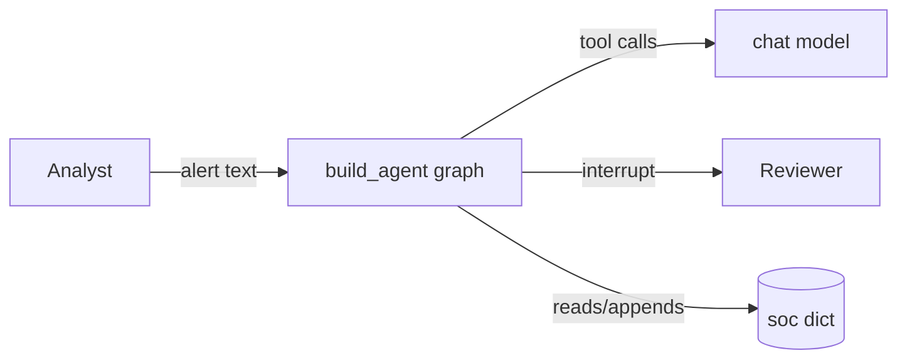
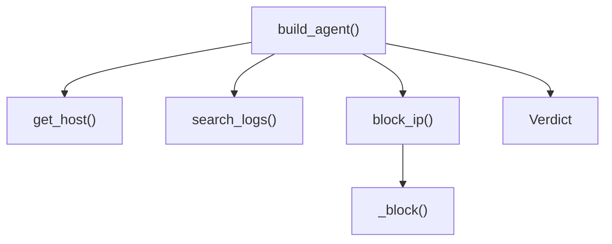
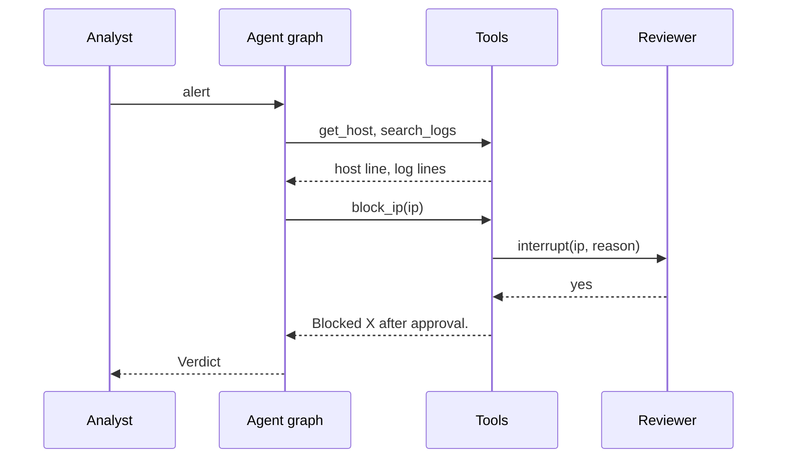
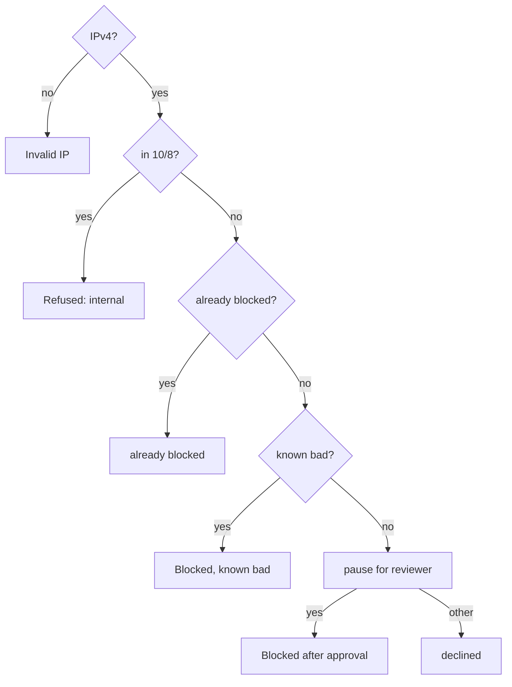
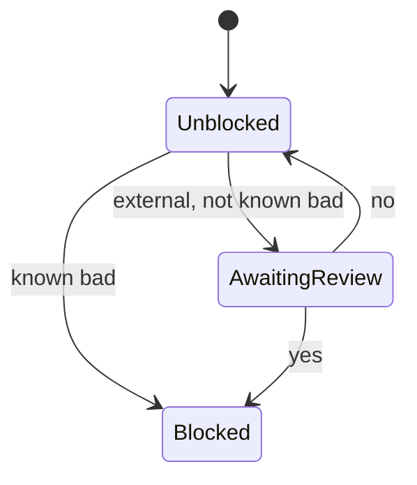
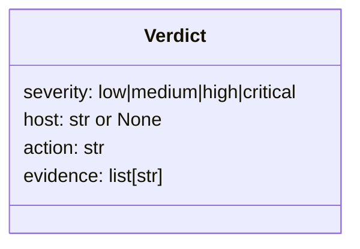

# System model

## Goals
- Outcome: an analyst sends an alert and gets a validated `Verdict`; external attackers are blocked, with reviewer approval unless known bad.
- Quality goals: correct blocks, rule order honoured, bounded searches, verdict always valid.

## 1. Context: who and what is outside the system?

## 2. Building blocks: which part owns what?

| Block | Owns | Code |
|---|---|---|
| Agent factory | tools, loop, checkpointer | `build_agent()` |
| Host lookup | case-insensitive host table | `get_host()` |
| Log search | filtering, order, limit of 4 | `search_logs()` |
| Blocking | rules 1-5 and the pause | `_block()` |
| Final answer | validation | `Verdict` |

## 3. Main sequence: what happens, in order, on the main path?

## 4. Rules: in what order are the business rules checked?

## 5. States: what states does the main item move through?

## 6. Data: what are the typed contracts and state?

## Runtime: which function writes each record?
| Process | Trigger | Reads | Writes | Writer |
|---|---|---|---|---|
| block | model calls block_ip | soc known_bad, blocked | soc["blocked"] | `_block()` |
| search count | model calls search_logs | counter | counter | `search_logs()` |

## Contracts: what crosses between parts, and how it fails
| Crossing | Producer | Consumer | Shape | On failure |
|---|---|---|---|---|
| final answer | model | caller | `Verdict` | ValidationError text back to the model, which retries |
| approval | reviewer | `_block()` | resume string | anything but yes declines |

## Quality: what observable result shows each goal holds?
| Goal | Observable pattern | Test |
|---|---|---|
| rule order | internal IP refused, no pause | `test_rule2_internal_refused_before_anything_else` |
| bounded searches | 5th call returns limit text | `test_search_limit_four_per_agent` |
| no double block on resume | one entry per IP | `test_parallel_blocks_do_not_double_apply_on_resume` |
| valid verdict | bad verdict retried | `test_invalid_verdict_goes_back_for_retry` |

## Unknowns
| Unknown | What would decide it |
|---|---|
| should `now` filter future logs? | a log with ts after `now` in the data (none today) |
