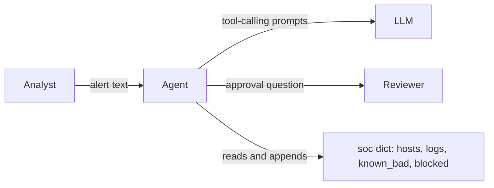
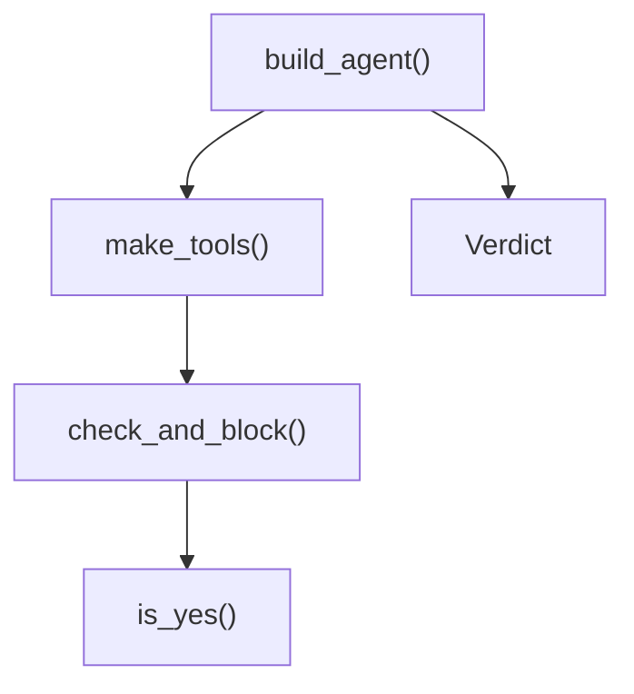
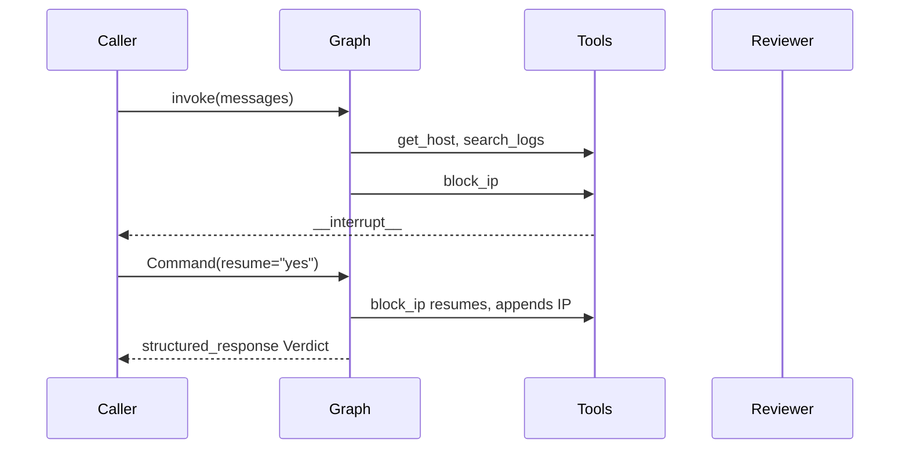
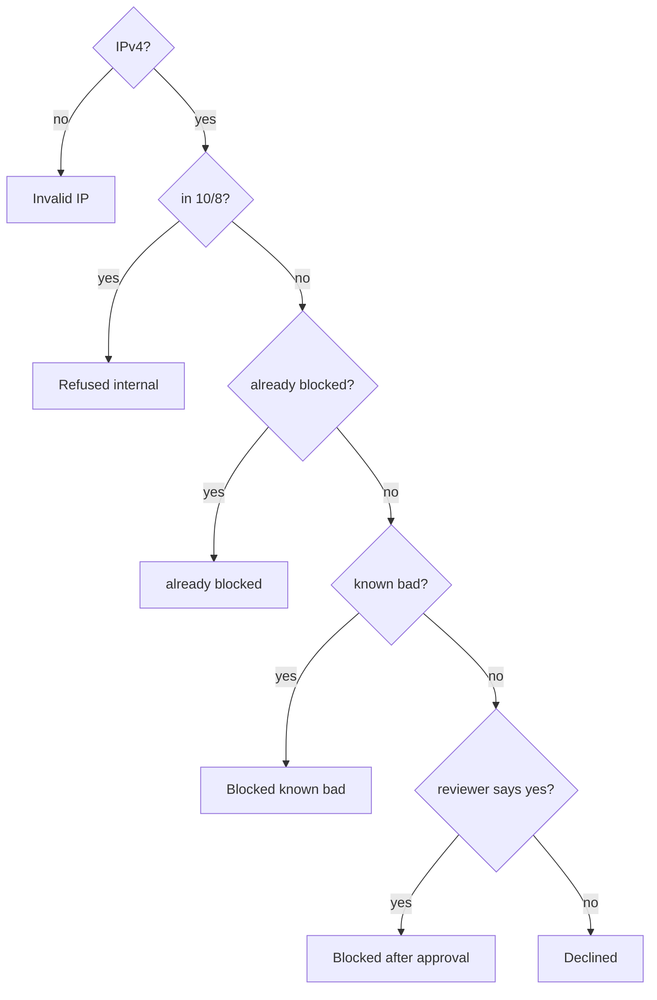
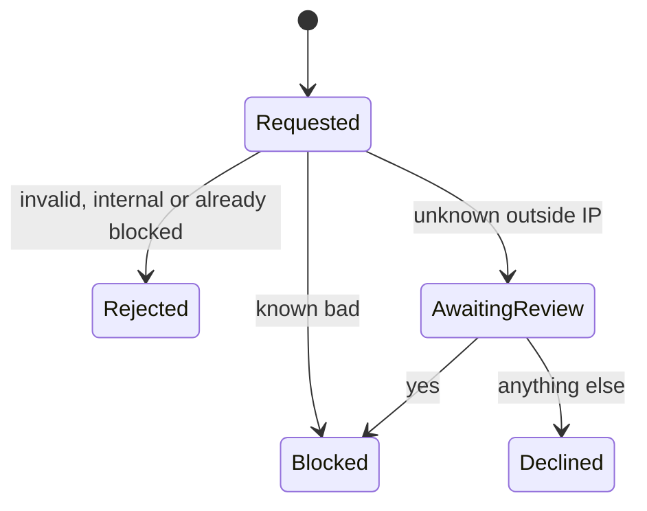
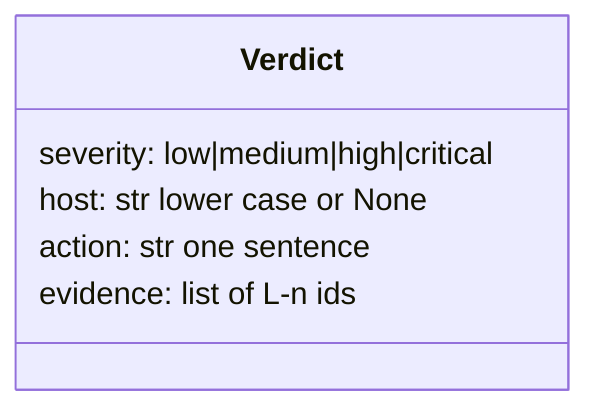

# System model

## Goals
- Outcome: an analyst sends an alert and gets a validated `Verdict`; outside IPs are blocked only by rule or with a reviewer's yes.
- Quality goals: correct blocks, bounded searches, validated final answer.

## 1. Context: who and what is outside the system?

## 2. Building blocks: which part owns what?

| Block | Owns | Code |
|---|---|---|
| graph | agent loop, checkpointer, structured output | `build_agent()` |
| tools | host lookup, log search, search counter | `make_tools()` |
| block rules | the five ordered rules and the pause | `check_and_block()` |
| final answer | validation | `Verdict` |

## 3. Main sequence: what happens, in order, on the main path?

## 4. Rules: in what order are the business rules checked?

## 5. States: what states does the main item move through?

## 6. Data: what are the typed contracts and state?

## Runtime: which function writes each record?
| Process | Trigger | Reads | Writes | Writer |
|---|---|---|---|---|
| block | block_ip tool call | soc blocked, known_bad | soc["blocked"] | `check_and_block()` |
| search count | search_logs call | counter | counter | `make_tools()` |

## Contracts: what crosses between parts, and how it fails
| Crossing | Producer | Consumer | Shape | On failure |
|---|---|---|---|---|
| final answer | LLM | caller | `Verdict` | validation error back to the LLM |
| approval | caller | block_ip | resume string | anything but yes declines |

## Quality: what observable result shows each goal holds?
| Goal | Observable pattern | Test |
|---|---|---|
| correct blocks | only rule 4 or a yes appends | `test_block_rule5_pauses_for_reviewer` |
| bounded searches | 5th call returns the limit text | `test_search_limit_counts_every_call_including_unknown_hosts` |
| validated answer | bad Verdict retried | `test_invalid_verdict_goes_back_for_retry` |

## Unknowns
| Unknown | What would decide it |
|---|---|
| two unknown-IP blocks in one turn give two pending interrupts; a plain resume then fails | a case with two reviewer pauses in one turn |
