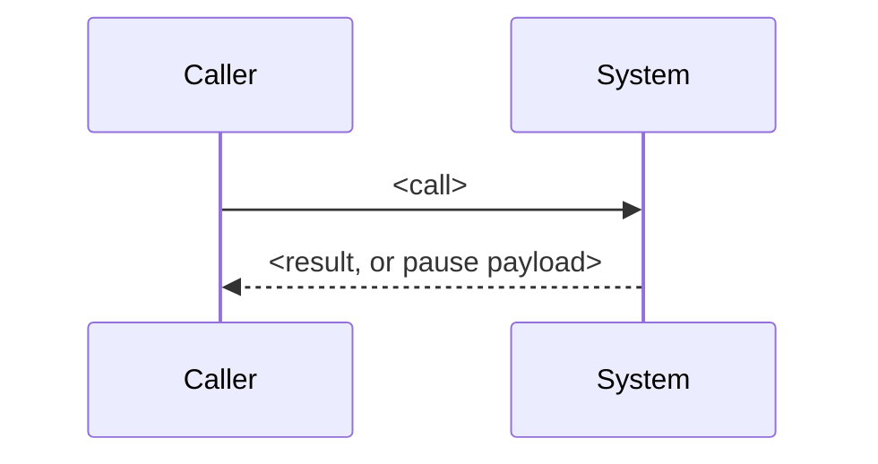

# System model: <system name>, <one sentence: what it does and its one key design choice>

Copy to `docs/MODEL.md` after `docs/PRD.md`, before writing code; keep it true as the code changes
(method/system-model.md). Draw only the diagrams that answer a question; the three below are
required, and Context, Agent loop or Components may be added when they answer one too.
Every box, arrow and row names a real function, class, tool or record. Write functions in
backticks with parentheses and classes in backticks: `check.sh --final` fails any function named
that way that the code does not define, and any backticked test name that no test file defines.
Under each heading write a bold "Answer:" line first (the kit's own convention): one sentence
answering the heading's question for this system. Give each part one label and use it unchanged
in every diagram. Draw the mechanism a decision rests on as the library really does it (a pause
returns to the caller; a resume re-runs the tool). A ten-line probe script that confirms the
behaviour is allowed before the model, and worth it.
Guidance in `<!-- -->` comments does not render; leave or delete it.

## Domain model: what are the things, and what must always be true of them?
**Answer:** <one sentence answering the heading>
<!-- The nouns from the use cases and the typed records that pass between parts. Write Literal
values out (Literal["approved", "refused"]), leave out +/- visibility markers, and keep
parentheses out of field lines. -->
```mermaid
classDiagram
  class <Model> {
    <field: type>
  }
```

Rules:
- <invariant that must always hold, e.g. a refund never exceeds the order total>

## State machine: what states does a run or record move through, and what is forbidden?
**Answer:** <one sentence answering the heading>
<!-- Include the human pause and the resume. Every arrow here, and every forbidden line below,
gets a row in "Tests from the model". If nothing has states, replace this section's diagram and

```mermaid
stateDiagram-v2
  [*] --> <first state>
  <first state> --> <next state>: <event>
  <next state> --> [*]
```

lists with one line: "No states: <reason>". -->


Forbidden:
- <state> --> <state>

## Sequence: UC2 <the riskiest use case, by its id in docs/PRD.md>
**Answer:** <one sentence answering: what happens, in order, in this use case?>
<!-- ->> is a call, -->> only its return. Give every tool its own lifeline, or none. A pause
returns to the caller; draw the resume as a new call from the caller and show what re-runs.
No ";" inside a message or Note: it breaks the diagram. -->


## Tests from the model
<!-- One row per state-machine arrow (copy it as written: "A --> B") and one per forbidden line,
plus one per domain rule. The test is the oracle for that claim. -->
| Claim | From | Test |
|---|---|---|
| [*] --> <first state> | state machine | `test_<what it shows>` |
| <first state> --> <next state> | state machine | `test_<what it shows>` |
| <next state> --> [*] | state machine | `test_<what it shows>` |
| <state> --> <state> | forbidden | `test_<what it shows>` |
| <invariant> | domain rule | `test_<what it shows>` |
