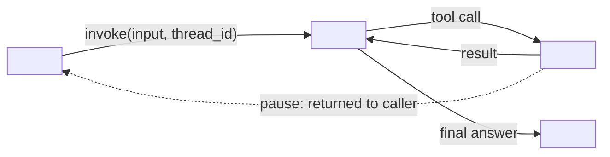
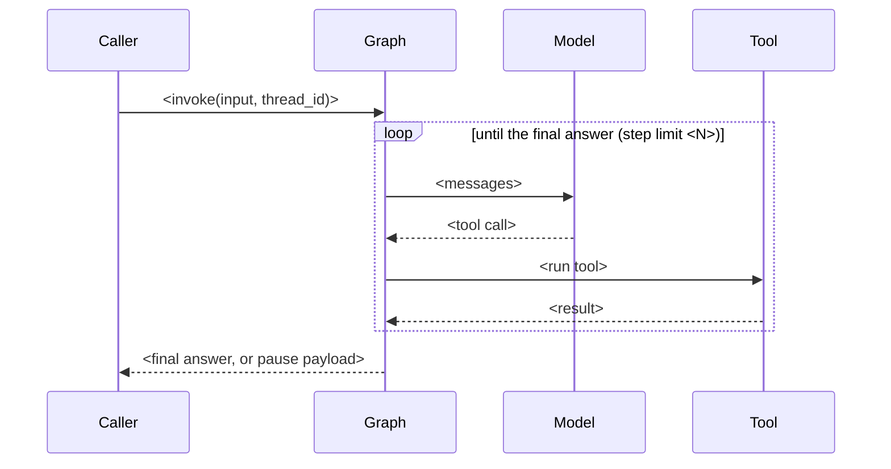

# System model: <system name>, <one sentence: what it does and its one key design choice>

Copy to `docs/MODEL.md` before writing code; keep it true as the code changes (method/system-model.md).
Every box, arrow and row names a real function, class, tool or record. Write functions in
backticks with parentheses and classes in backticks: `check.sh --final` fails any function named
that way that the code does not define, and any backticked test name that no test file defines.
Mark anything not yet decided (guessed). Each diagram answers the question in its heading.
Under each heading write two lines before the diagram: a bold "Answer:" line, one sentence
answering the heading for this system; then an italic line saying whether the view is current
or proposed and what its arrows mean (one meaning per diagram). Give each part one label and use
it unchanged in every diagram (same node id, same text). Draw the mechanism a decision rests on
as the library really does it (a pause returns to the caller; a resume re-runs the tool).

## Goals
- Outcome: <who does what, and what they see when it works>
- Quality goals: <2 to 4, e.g. correct refunds, bounded steps, explainable answer>

## 1. Context: who and what is outside the system?
**Answer:** <one sentence answering the heading>
*View: <current or proposed>. Arrows mean: <one meaning>.*
```mermaid
flowchart LR
  <Person or caller> -->|<what they send>| <System>
  <System> -->|<what it calls>| <External system or model>
```

## 2. Agent loop: which part runs each step, and where does the run stop or pause?
**Answer:** <one sentence answering the heading>
*View: <current or proposed>. Arrows mean: <one meaning>.*


Who owns what (one row per part; mark the only writer of each record):

| Block | Owns | Code |
|---|---|---|
| <part> | <what it decides or holds> | `<function()>` |

## 3. Main sequence: what happens, in order, on the main path?
**Answer:** <one sentence answering the heading>
*View: <current or proposed>. Arrows mean: <one meaning>.*

`->>` is a call, `-->>` only its return. Give every tool its own lifeline, or none. A pause
returns to the caller; draw the resume as a new call from the caller and show what re-runs.

## 4. Rules: in what order are the business rules checked?
**Answer:** <one sentence answering the heading>
*View: <current or proposed>. Arrows mean: <one meaning>.*
| # | Check (first match wins) | Result text | Code |
|---|---|---|---|
| 1 | <check> | <exact text> | `<function()>` |

Draw a flowchart only for the branches after the straight chain:
```mermaid
flowchart LR
  <gate?> -->|yes| <outcome>
  <gate?> -->|no| <other outcome>
```

## 5. States: what states does a run or record move through, including pauses and resumes?
**Answer:** <one sentence answering the heading>
*View: <current or proposed>. Arrows mean: <one meaning>.*
Draw only states the rules in section 4 do not already show (paused, checkpointed, resumed,
retried).


```mermaid
stateDiagram-v2
  [*] --> <first state>
  <first state> --> <next state>: <event>
```

## 6. Data: what are the typed contracts and state?
**Answer:** <one sentence answering the heading>
*View: <current or proposed>. Arrows mean: <one meaning>.*
Write Literal values out (`Literal["approved", "refused"]`), list each validator under its
field, and leave out `+`/`-` visibility markers.
```mermaid
classDiagram
  class <Model> {
    <field: type>
  }
```

## Runtime: which function writes each record?
| Process | Trigger | Reads | Writes | Writer |
|---|---|---|---|---|
| <process> | <what starts it> | <inputs> | <record changed> | `<function()>` |

## Contracts: what crosses between parts, and how it fails
| Crossing | Producer | Consumer | Shape | On failure |
|---|---|---|---|---|
| <crossing> | <part> | <part> | <type or schema> | <what happens> |

## Quality: what observable result shows each goal holds?
| Goal | Observable pattern | Test |
|---|---|---|
| <goal> | <what you would see> | `<test name>` |

## Unknowns
| Unknown | What would decide it |
|---|---|
| <open question> | <the evidence that settles it> |
