# System model

Copy to `docs/MODEL.md` before writing code; keep it true as the code changes (method/system-model.md).
Every box, arrow and row names a real function, class, tool or record. Write functions in
backticks with parentheses and classes in backticks: `check.sh --final` fails any function named
that way that the code does not define, and any backticked test name that no test file defines.
Mark anything not yet decided (guessed). Each diagram answers the question in its heading. If
nothing in the system changes state, replace diagram 5 with one line starting "No states:" and
the reason.

## Goals
- Outcome: <who does what, and what they see when it works>
- Quality goals: <2 to 4, e.g. correct refunds, bounded steps, explainable answer>

## 1. Context: who and what is outside the system?
```mermaid
flowchart LR
  <Person or caller> -->|<what they send>| <System>
  <System> -->|<what it calls>| <External system or model>
```

## 2. Building blocks: which part owns what?
```mermaid
flowchart TB
  <entry function()> --> <part function()>
```

| Block | Owns | Code |
|---|---|---|
| <part> | <what it decides or holds> | `<function()>` |

## 3. Main sequence: what happens, in order, on the main path?
```mermaid
sequenceDiagram
  participant <Caller>
  participant <Part>
  <Caller>->><Part>: <call>
  <Part>-->><Caller>: <result>
```

## 4. Rules: in what order are the business rules checked?
```mermaid
flowchart TD
  <first check?> -->|yes| <outcome>
  <first check?> -->|no| <next check?>
```

## 5. States: what states does the main item move through?

```mermaid
stateDiagram-v2
  [*] --> <first state>
  <first state> --> <next state>: <event>
```


## 6. Data: what are the typed contracts and state?
```mermaid
classDiagram
  class <Model> {
    <field: type>
  }
```

## Runtime: which function writes each record?
| Process | Trigger | Reads | Writes | Writer |
|---|---|---|---|---|
| <process> | <what starts it> | <inputs> | <record changed> | `<function()>` |

## Contracts: what crosses between parts, and how it fails
| Crossing | Producer | Consumer | Shape | On failure |
|---|---|---|---|---|
| <crossing> | <part> | <part> | <type or schema> | <what happens> |

## Quality: what observable result shows each goal holds?
| Goal | Observable pattern | Test |
|---|---|---|
| <goal> | <what you would see> | `<test name>` |

## Unknowns
| Unknown | What would decide it |
|---|---|
| <open question> | <the evidence that settles it> |
