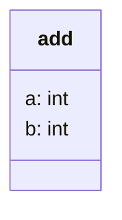
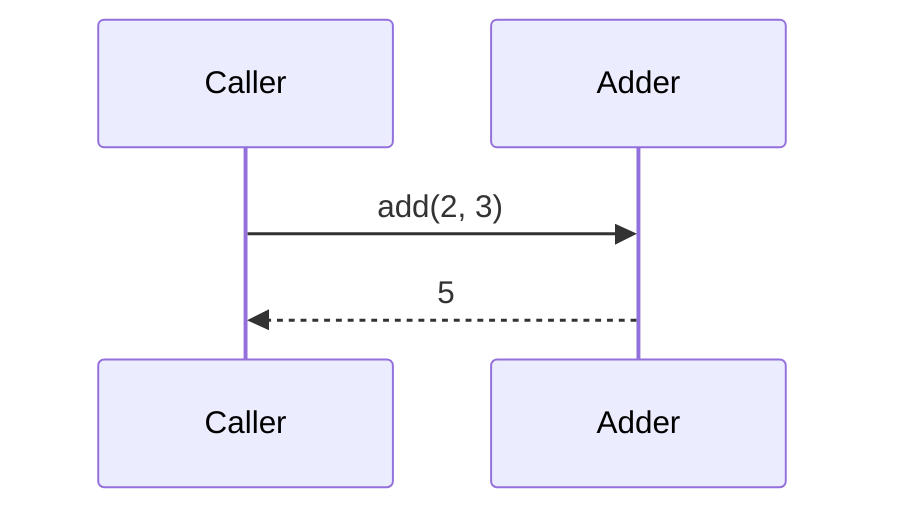

# System model: adder, adds two numbers with one pure function

## Domain model: what are the things, and what must always be true of them?
**Answer:** two ints in, one int out.

Rules:
- the result equals a + b

## State machine: what states does a run or record move through, and what is forbidden?
No states: add is a pure function.

## Sequence: UC1 add two numbers
**Answer:** one call, one return.

## Tests from the model
| Claim | From | Test |
|---|---|---|
| the result equals a + b, via `add()` | domain rule | `test_add` |
