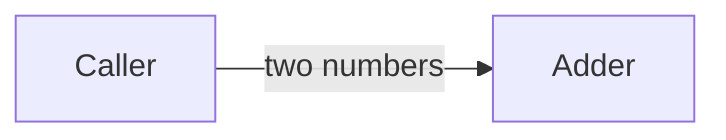
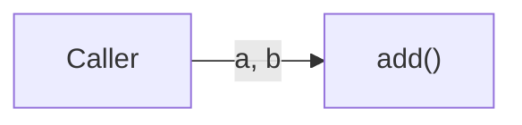
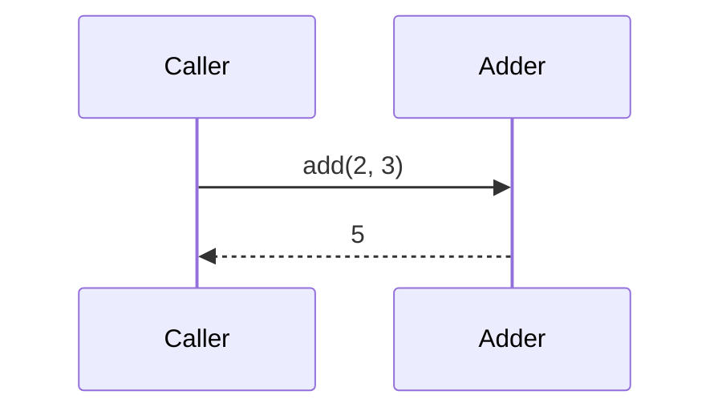
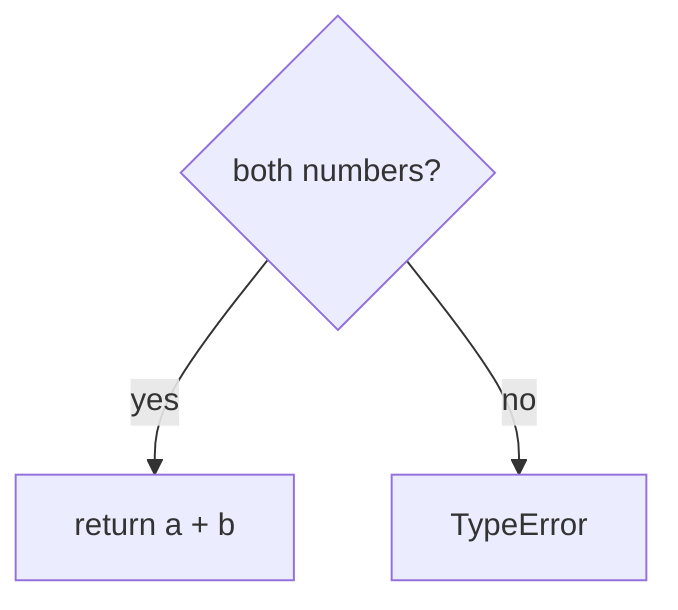
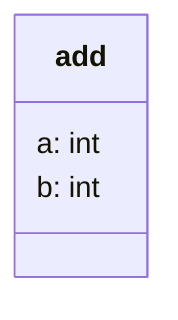

# System model: adder, adds two numbers with one pure function

## Goals
- Outcome: a caller adds two numbers and sees the sum.
- Quality goals: correct sum.

## 1. Context: who and what is outside the system?
**Answer:** only the caller.
*View: current. Arrows mean: sends to.*

## 2. Agent loop: which part runs each step, and where does the run stop or pause?
**Answer:** there is no loop; `add()` runs once and returns.
*View: current. Arrows mean: calls.*

| Block | Owns | Code |
|---|---|---|
| adder | the sum | `add()` |

## 3. Main sequence: what happens, in order, on the main path?
**Answer:** one call, one return.

## 4. Rules: in what order are the business rules checked?
**Answer:** one check: both inputs are numbers.

## 5. States: what states does a run or record move through, including pauses and resumes?
**Answer:** none.
No states: add is a pure function.

## 6. Data: what are the typed contracts and state?
**Answer:** two ints in.

## Runtime: which function writes each record?
| Process | Trigger | Reads | Writes | Writer |
|---|---|---|---|---|
| add | a call | a, b | nothing | `add()` |

## Contracts: what crosses between parts, and how it fails
| Crossing | Producer | Consumer | Shape | On failure |
|---|---|---|---|---|
| call | Caller | add | two ints | TypeError |

## Quality: what observable result shows each goal holds?
| Goal | Observable pattern | Test |
|---|---|---|
| correct sum | 2 + 3 = 5 | `test_add` |

## Unknowns
| Unknown | What would decide it |
|---|---|
| floats allowed? | a task line saying so |
